# Boot flow: reset → PMP configuration → S-mode handover → Sv39 MMU

This document follows U54_1 from reset to the first FreeRTOS task running in
supervisor mode with the Sv39 MMU on, and shows what M-mode keeps doing
afterwards. The diagrams are [Mermaid](https://mermaid.js.org/), which GitHub
renders inline.

Applies to branch **`mmu-sv39`**, `make` build of the libraries and
`examples/freertos-demo` (`IMAGE_LOADED_BY_BOOTLOADER = 0`,
`MPFS_HAL_HW_CONFIG` defined, `DDR_SUPPORT` off). Stages 1–7 and 9 are in the
static libraries (`libmpfs_smode_boot.a`, `libfreertos_smode.a`); the
application provides `s_mode_main()` and, optionally, `smode_m_prehook()`. The image is linked by
`src/boards/icicle-kit-es/platform_config/linker/mpfs-lim-sv39.ld`: every
section is **linked at its virtual address** in the upper half of the Sv39
address space (`0xFFFFFFC0_08000000`) and **loaded at its physical address**
in L2LIM (`0x08000000`). M-mode runs the physical copy with the MMU off;
S-mode turns the MMU on in `smode_start` and continues at the virtual alias
([section 6](#6-sv39-bring-up-smode_starts-sv39c)).

| Stage | Privilege | Hart(s) | Code |
|---|---|---|---|
| 1. Reset entry | M | all | `src/platform/mpfs_hal/startup_gcc/mss_entry.S` |
| 2. Platform init, wake other harts | M | E51 | `main_first_hart()` in `src/platform/mpfs_hal/startup_gcc/system_startup.c` |
| 3. Per-hart dispatch | M | all | `main_other_hart()` in `system_startup.c` |
| 4. Other harts (not handled by the libraries) | M | E51, U54_2..4 | HAL weak `e51()`/`u54_N()`, or the application's (demo: `examples/freertos-demo/other_harts.c`) |
| 5. Application M-mode pre-hook, PLIC S-context clean slate | M | U54_1 | `u54_1()` in `src/smode/u54_1_boot.c`; demo pre-hook `examples/freertos-demo/m_prehook.c` |
| 6. Delegation, PMP, `satp = 0`, `mret` | M → S | U54_1 | `m_shim_enter_smode()` in `src/smode/m_shim.c` |
| 7. Sv39 page tables, `satp` on, jump to the virtual alias, FreeRTOS trap handler | S (MMU off → on) | U54_1 | `smode_start` in `src/smode/smode_start.S`, `sv39_build()` in `src/smode/sv39.c`, `smode_os_init()` in `src/freertos_glue/smode_irq.c` |
| 8. FreeRTOS start | S (virtual) | U54_1 | the application's `s_mode_main()` (demo: `examples/freertos-demo/app_main.c`), `portable/GCC/RISC-V-SMode/` |
| 9. Runtime traps into M-mode | M (physical) | U54_1 | `src/smode/m_shim_trap.S`, `m_shim.c` |

## 1. Overview

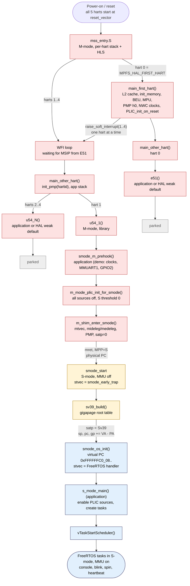

Red = M-mode (physical addresses), yellow = S-mode with the MMU still off,
blue = S-mode with Sv39 on (virtual addresses), grey = parked.

## 2. Reset entry (`mss_entry.S`)

Every hart runs the same reset code. Only the hart that equals
`MPFS_HAL_FIRST_HART` (0, the E51) continues to `main_first_hart`; the others
sit in WFI until the E51 sends them a machine software interrupt.

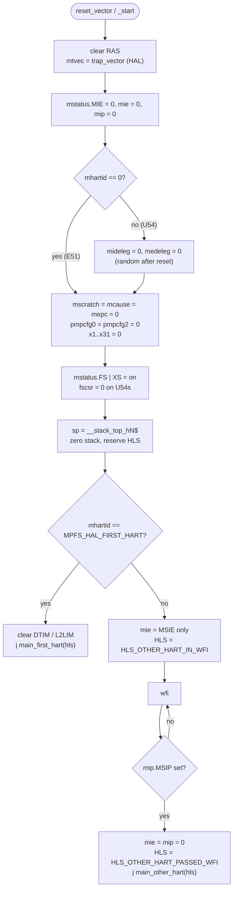

Notes:

* PMP is cleared here (`pmpcfg0/2 = 0`). M-mode ignores PMP entries that are
  not locked, so this has no effect until the hart drops to S-mode. It is
  reprogrammed (and entry 0 locked) by `init_pmp()` in `main_other_hart()`,
  see [section 5](#memory-configuration-at-the-moment-of-mret).
* `mstatus.FS` is turned on here and is never turned off, which is what the
  S-mode port needs for `configENABLE_FPU = 1`.

## 3. E51 brings up the platform and releases the U54s

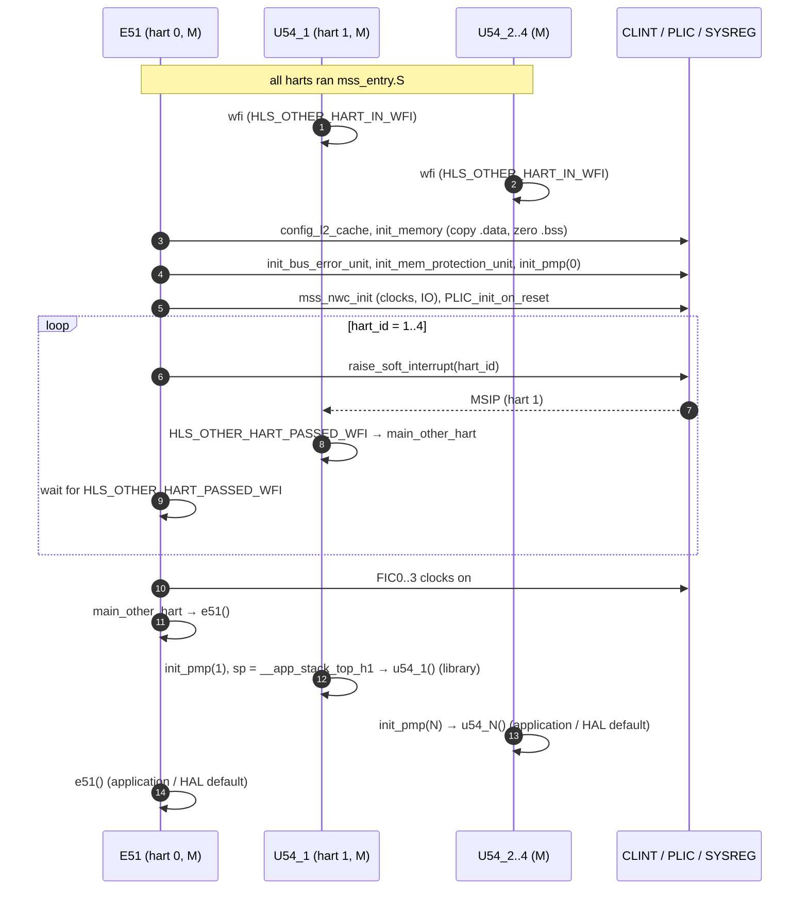

The E51 has finished the whole platform start-up (memory, clocks, PLIC)
before it releases any U54, so `u54_1()` needs no further handshake and the
libraries do not depend on what the E51 runs afterwards. The libraries only
define `u54_1()`. The other harts run the application's `e51()` /
`u54_2..4()` or, without them, the HAL's weak defaults, whose `park_hart()`
jumps to the boot-ROM park loop at `0x20003120` in eNVM. That suits a board
programmed with HSS; in Renode (empty eNVM) define your own, as the demo does
in `examples/freertos-demo/other_harts.c` (UART0 banner on the E51, then WFI).

## 4. U54_1 M-mode set-up (`u54_1()` in `src/smode/u54_1_boot.c`)

The library does only what the S-mode kernel needs; everything else that needs
`mhartid` or M-mode (clocks, resets, UARTs, GPIO interrupt enables...) goes in
the application's `smode_m_prehook()`, because S-mode cannot read `mhartid`
and the HAL helpers use it. All of it runs from the physical copy of L2LIM,
so addresses taken here (`smode_start`, `g_s_boot_stack`) are physical, which
is what `mret` and the first S-mode instructions need.

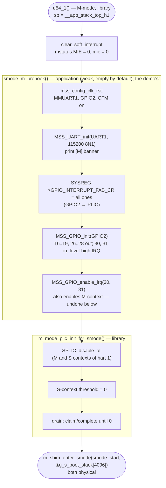

Interrupt sources are enabled for the S context by the application, from
S-mode, in `s_mode_main()` (`PLIC_SetPriority()` + `SPLIC_enable()`; the demo
enables 43, 44 and 118). They are not taken before the scheduler starts,
because `sstatus.SIE` is 0 until then.

## 5. The handover: `m_shim_enter_smode()`

This is where memory protection for S-mode is configured, the trap routing is
set up, and the hart changes privilege. The MMU is deliberately left **off**
(`satp = 0`): the shim does not know the image's virtual layout, and the
S-mode entry code builds its own page tables
([section 6](#6-sv39-bring-up-smode_starts-sv39c)).

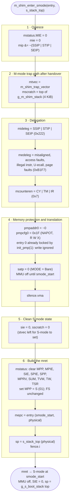

### Memory configuration at the moment of `mret`

**Address translation (MMU).** `satp = 0` selects `MODE = Bare`: until
`smode_start` turns Sv39 on, S-mode addresses are physical addresses. The
`sfence.vma` discards any stale TLB entries. Once Sv39 is on, an unmapped or
wrongly-permissioned access raises a page fault (12, 13, 15); those are in
`medeleg`, so they go to S-mode's `stvec` — `smode_early_trap` during the
switch, the FreeRTOS handler afterwards.

**PMP.** S-mode and U-mode accesses must match a PMP entry, otherwise they
fault (M-mode is unaffected by unlocked entries). The shim asks for one NAPOT
entry covering the whole address space with RWX. This lets S-mode reach L2LIM
(code/data/heap), MMUART1, GPIO2, the PLIC S-context registers and CLINT
`mtime` at `0x0200BFF8`.

> **PMP entry 0 is already locked when the shim runs.** `main_other_hart()`
> calls `init_pmp(1)` → `pmp_configure(1)`, which (with
> `LIBERO_SETTING_MEM_CONFIGS_ENABLED = 0`) writes the Libero values from
> `hw_pmp_hart1.h`: `pmpaddr0 = ~0`, `pmpcfg0 = 0x9F` = **L** | NAPOT | RWX.
> Locked entries ignore writes until reset, so on hardware that honours the
> lock bit the shim's `pmpaddr0`/`pmpcfg0` write does not change entry 0
> (the write does clear the cfg bytes of entries 1–7, which are 0 anyway).
> The effective result is the same — whole space RWX for S/U — but entry 0
> is locked, so it also applies to M-mode and cannot be tightened later
> without a reset. To restrict PMP for S-mode, override the weak
> `init_pmp()` (or skip it for hart 1) so that the entries stay unlocked
> until `m_shim_enter_smode()` programs them.

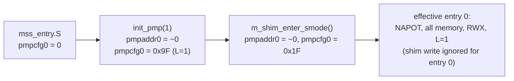

Every S-mode access goes through both checks, translation first:

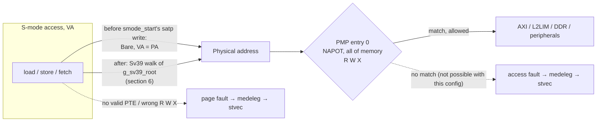

**CSR state after `mret`:**

| CSR | Value | Why |
|---|---|---|
| privilege | S | `mstatus.MPP = 01` |
| `pc` | `smode_start`, **physical** (`0x0800....`) | `mepc`; `u54_1()` took the address while running physical |
| `sp` | `&g_s_boot_stack[4096]`, physical | set right before `mret` |
| `gp` | physical alias of `__global_pointer$` | set by the HAL in M-mode; moved by `smode_start` |
| `sstatus.SIE` / `SPIE` / `SPP` | 0 / 0 / 0 | interrupts off until the scheduler starts |
| `sstatus.FS` | on (from `mss_entry.S`) | FPU context saved by the port |
| `satp` | 0 | Bare; Sv39 is turned on by `smode_start` |
| `pmpcfg0` / `pmpaddr0` | `0x9F` / `~0` (shim writes `0x1F`, see note above) | whole space RWX for S/U, entry locked by the HAL |
| `mideleg` | `0x222` | SSIP, STIP, SEIP go straight to S-mode |
| `medeleg` | `0xB1F7` | faults, illegal instr, U-ecall go to S-mode; breakpoint (3) and S-ecall (9) stay in M |
| `mie` | 0 | only `MTIE` is ever set later, by SBI `set_timer` |
| `mtvec` / `mscratch` | `m_shim_trap_vector` / M stack top | M-mode traps never use the S-mode stack |
| `sie`, `sscratch` | 0 | set by the port / unused |
| `stvec` | not yet set | `smode_early_trap` is written first thing in `smode_start` |

## 6. Sv39 bring-up (`smode_start.S`, `sv39.c`)

`smode_start` is the S-mode entry point. It starts with the MMU off, running
the physical copy, and ends by calling `s_mode_main()` at the virtual alias.

### Address map

`sv39_build()` uses **gigapages only** (1 GiB leaf PTEs in the root table, no
second-level tables). The layout comes from the linker script
(`__l2lim_start`, `__l2lim_pa_start`, `__ddr_cached_38bit_*`):

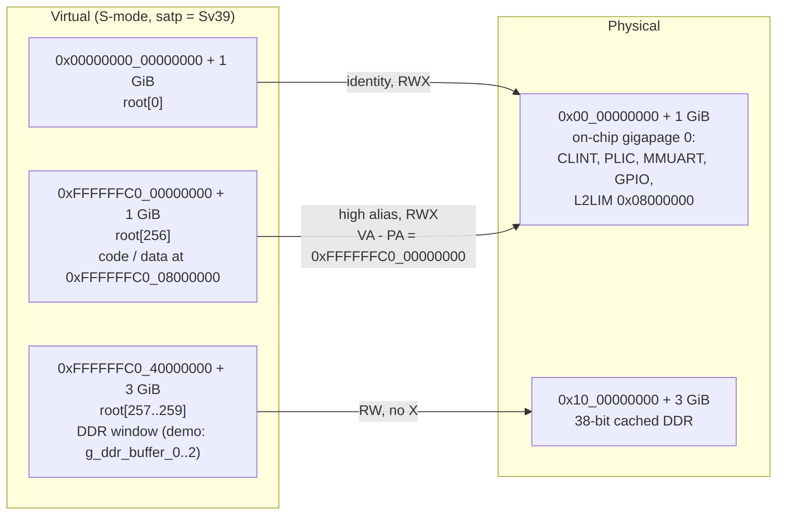

| Root index | VA | PA | Perms | Why |
|---|---|---|---|---|
| 0 | `0x0` | `0x0` | RWX | identity map: the HAL drivers use physical peripheral addresses, and the instructions right after the `satp` write still execute from the physical copy |
| 256 | `0xFFFFFFC0_00000000` | `0x0` | RWX | high alias of on-chip gigapage 0: where the kernel's code and data run |
| 257–259 | `0xFFFFFFC0_40000000` | `0x10_00000000` | RW | 3 GiB DDR window, data only; the demo splits it into `g_ddr_buffer_0..2` (`examples/freertos-demo/ddr_buffers.ld`) |

All leaves have `V | G | A | D` set (A/D pre-set so the hardware never needs
to update them, which some implementations do by raising a page fault). No
`U` bit: nothing is accessible from U-mode.

### Switch-over sequence

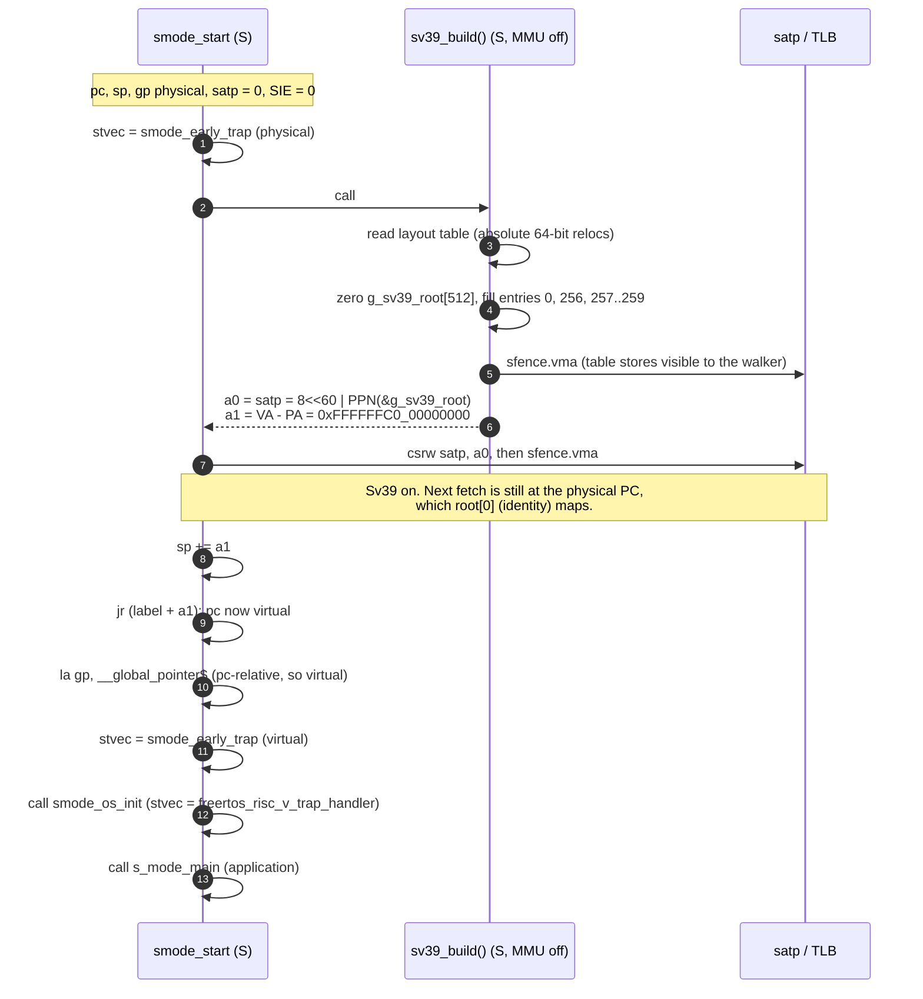

On Renode the console then shows, for example,
`satp=0x800000000000801a` (root table at PA `0x0801A000`) and
`running at 0xffffffc008000eb0 (s_mode_main)`.

### One image, two address views

M-mode (HAL start-up, `u54_1()`, the shim) and `smode_start` before the
switch run the **same code** as S-mode, but from its physical copy:

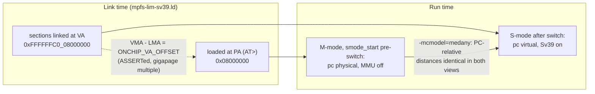

Consequences:

* **PC-relative addressing works in both views** because the whole on-chip
  gigapage is aliased with a single offset. `la sym` gives a physical
  address when run physical, a virtual one when run virtual.
* **Absolute pointers in data** (function-pointer tables such as the HAL's
  `ext_irq_handler_table`, linker-filled tables) hold **virtual** addresses
  and are only valid in S-mode with the MMU on.
* **`sv39_build()` reads the layout from a `volatile` table** of absolute
  relocations, because referencing absolute linker symbols PC-relatively
  from the physical copy would give the wrong value.
* **`gp`**: S-mode moves `gp` to the virtual alias. The M-mode trap vector
  (`m_shim_trap.S`) saves the interrupted `gp`, loads its own (physical) one
  with `la gp, __global_pointer$`, and restores S-mode's `gp` before `mret`.
* **SBI arguments are scalars** (timer value, hart mask), so M-mode never has
  to translate an S-mode virtual address. The debug call
  `SBI_SHIM_READ_PHYS_U64` takes a physical address and only accepts the DDR
  window.
* **Faults during the switch** go to `smode_early_trap`, which is position
  independent and reports `scause`/`sepc`/`stval` through
  `smode_early_trap_report()` → `smode_diag_puts()` (`src/smode/smode_diag.c`;
  UART1 in the demo), then parks.

## 7. Privilege levels on U54_1

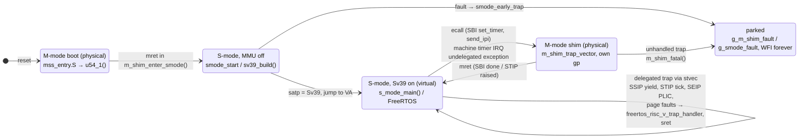

## 8. S-mode start-up and the first tick

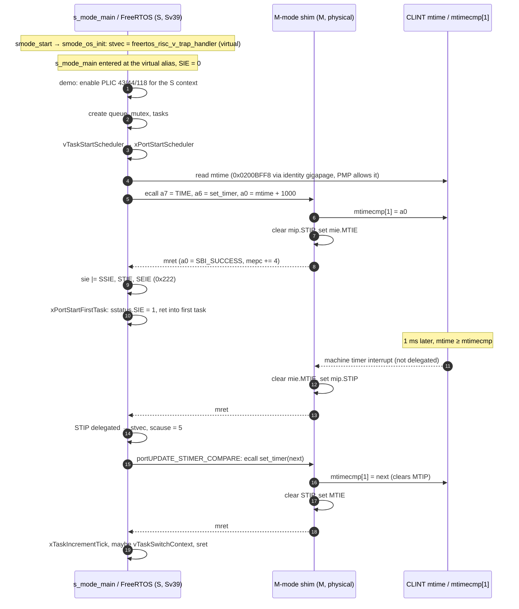

Other trap paths after the handover:

* **Yield** – with `configPORT_YIELD_VIA_SBI_IPI = 1` (this project's
  default, for Renode 1.13) `portYIELD()` makes an SBI `IPI.send_ipi` ecall
  to its own hart and the shim sets `mip.SSIP`; with 0 it writes `sip.SSIP`
  directly. Either way SSIP is delegated and taken as scause 1 by the port,
  which clears it and switches context. See `src/middleware/README.md`
  section 3.2 for why Renode needs the M-mode write.
* **PLIC** – sources the application enabled (demo: 43/44/118) assert SEIP
  on hart 1's S-context; delegated, `src/freertos_glue/smode_irq.c` claims/completes on the S-context and calls the HAL handler
  table entries.
* **Exceptions** – delegated faults, including page faults, go to
  `freertos_risc_v_application_exception_handler` (`smode_irq.c`), which
  records `g_smode_fault` and reports through `smode_diag_puts()`. Before FreeRTOS installs its handler they go to
  `smode_early_trap`. Breakpoints stay in M-mode for the debugger.

## 9. Memory used during the handover

| Region | Address (VA → PA) | Used for |
|---|---|---|
| L2LIM | `0xFFFFFFC0_08000000` → `0x08000000`, 255 KiB | code, data, bss, FreeRTOS heap (`mpfs-lim-sv39.ld`) |
| `__app_stack_top_h1` | L2LIM | U54_1 M-mode stack until `mret` (used physical) |
| `g_s_boot_stack` | `.bss`, 4 KiB | S-mode stack for `smode_start` / `s_mode_main()` until the scheduler starts (physical, then virtual after `sp += a1`); unused afterwards |
| `g_sv39_root` | `.bss`, 4 KiB, page aligned | Sv39 root page table; `satp.PPN` is its physical address |
| `xISRStack` | `.bss`, 512 words | S-mode trap stack (`configISR_STACK_SIZE_WORDS`) |
| `g_m_shim_stack` | `.bss`, 4 KiB | M-mode stack for traps after the handover (via `mscratch`, physical) |
| `g_ddr_buffer_0..2` (demo) | `0xFFFFFFC0_40000000` → `0x10_00000000`, 3 x 1 GiB | DDR buffers: linker symbols from the demo's `ddr_buffers.ld`, no section and no load segment (nothing loaded or cleared) |
| CLINT `mtime` | `0x0200BFF8` (identity) | read directly by S-mode (no `time` CSR on the U54) |
| CLINT `mtimecmp[1]` | `0x02004008` | written only by the M-mode shim |

## Notes on running with the MMU on

* **PMP is still wide open.** Paging protects S-mode from U-mode; PMP is what
  protects M-mode from S-mode. With paging on, S-mode can still map any
  physical address it likes, so tighten PMP (after unlocking entry 0, see
  [section 5](#memory-configuration-at-the-moment-of-mret)) before relying on
  it for isolation.
* **The identity gigapage is RWX** so the HAL drivers keep working with
  physical register addresses. Removing it means remapping the peripherals
  and changing the drivers' base addresses.
* **One ASID, global mappings.** `satp.ASID = 0` and every PTE has `G` set:
  there is a single address space, so tasks share it and context switches
  never touch `satp`.
* **Loading the image.** The ELF entry point is virtual
  (`0xFFFFFFC0_08000000`); the SoftConsole launcher loads
  `build/examples/freertos-demo/freertos-demo.elf` with gdb and
  sets every hart's `pc` to the physical `0x08000000`. A monitor-only flow
  can use `sysbus LoadELF` (it loads at the physical addresses) followed by
  `sysbus.<hart> PC 0x08000000` for each hart. The DDR buffers are linker
  symbols, not a section, so there is no 3 GiB segment to load.
