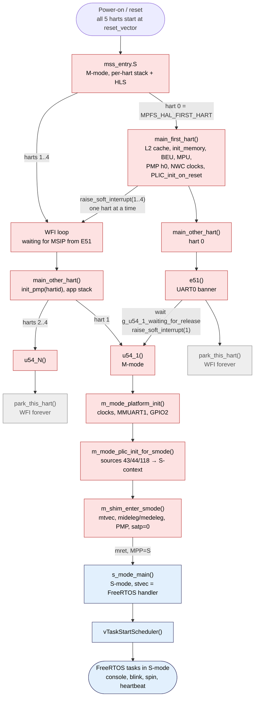
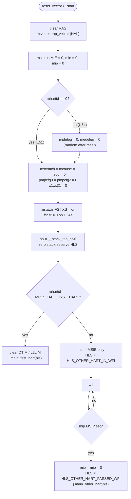
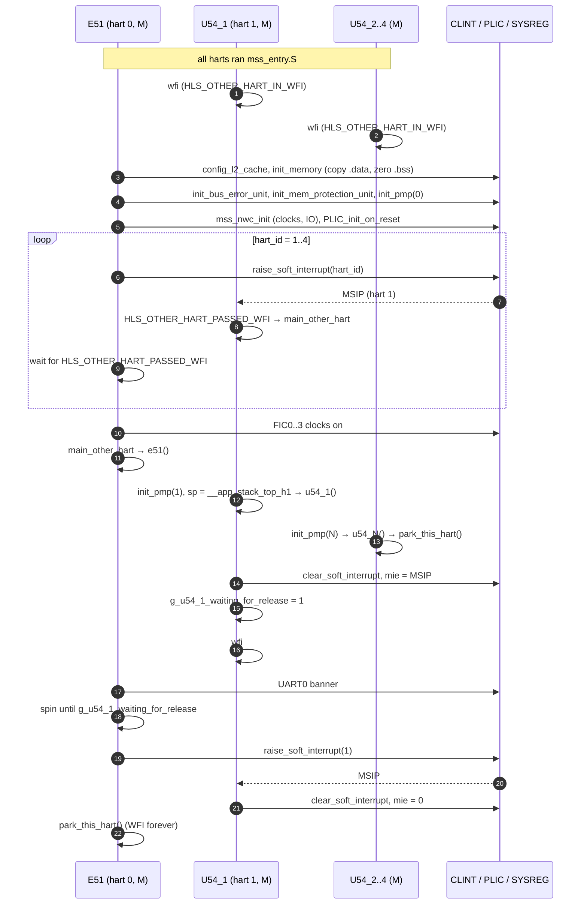
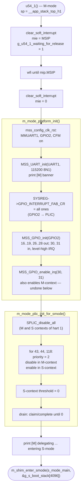
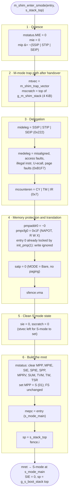
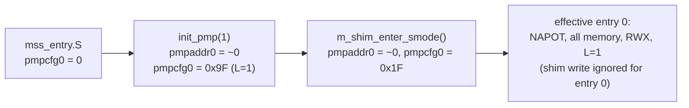
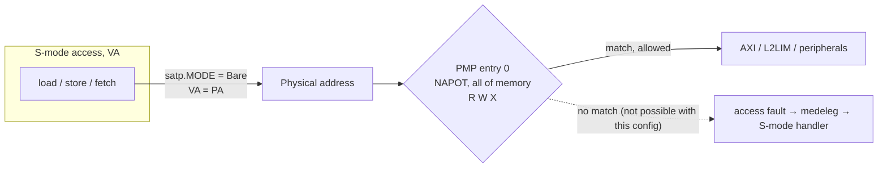
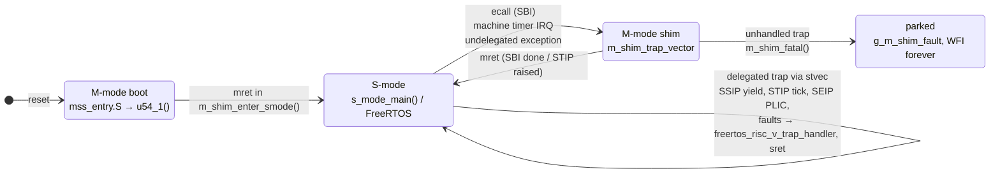
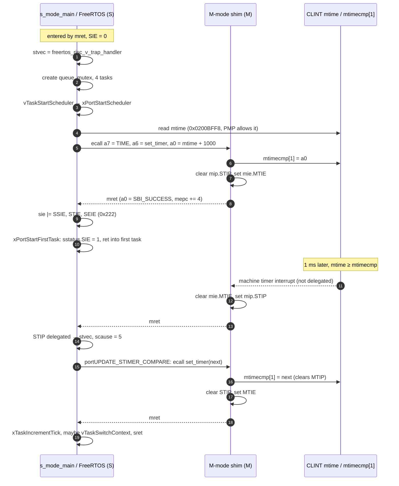

# Boot flow: reset → MMU/PMP configuration → S-mode handover

This document follows U54_1 from reset to the first FreeRTOS task running in
supervisor mode, and shows what M-mode keeps doing afterwards. The diagrams
are [Mermaid](https://mermaid.js.org/), which GitHub renders inline.

Applies to the **LIM-Debug** configuration (`IMAGE_LOADED_BY_BOOTLOADER = 0`,
`MPFS_HAL_HW_CONFIG` defined, `DDR_SUPPORT` off, image linked into L2LIM by
`mpfs-lim.ld`).

| Stage | Privilege | Hart(s) | Code |
|---|---|---|---|
| 1. Reset entry | M | all | `src/platform/mpfs_hal/startup_gcc/mss_entry.S` |
| 2. Platform init, wake other harts | M | E51 | `main_first_hart()` in `src/platform/mpfs_hal/startup_gcc/system_startup.c` |
| 3. Per-hart dispatch | M | all | `main_other_hart()` in `system_startup.c` |
| 4. Release U54_1, park | M | E51, U54_2..4 | `src/application/hart0/e51.c`, `hart2..4/u54_N.c`, `inc/hart_park.h` |
| 5. Peripheral + PLIC S-context set-up | M | U54_1 | `src/application/hart1/u54_1.c` |
| 6. Delegation, PMP, `satp`, `mret` | M → S | U54_1 | `m_shim_enter_smode()` in `src/application/smode/m_shim.c` |
| 7. FreeRTOS start | S | U54_1 | `s_mode_main()` in `src/application/hart1/app_main.c`, `portable/GCC/RISC-V-SMode/` |
| 8. Runtime traps into M-mode | M | U54_1 | `src/application/smode/m_shim_trap.S`, `m_shim.c` |

## 1. Overview

Red = M-mode, blue = S-mode, grey = parked.

## 2. Reset entry (`mss_entry.S`)

Every hart runs the same reset code. Only the hart that equals
`MPFS_HAL_FIRST_HART` (0, the E51) continues to `main_first_hart`; the others
sit in WFI until the E51 sends them a machine software interrupt.

Notes:

* PMP is cleared here (`pmpcfg0/2 = 0`). M-mode ignores PMP entries that are
  not locked, so this has no effect until the hart drops to S-mode. It is
  reprogrammed (and entry 0 locked) by `init_pmp()` in `main_other_hart()`,
  see [section 5](#memory-configuration-at-the-moment-of-mret).
* `mstatus.FS` is turned on here and is never turned off, which is what the
  S-mode port needs for `configENABLE_FPU = 1`.

## 3. E51 brings up the platform and releases U54_1

U54_1 waits twice: the HAL wake-up (steps 4–6) gets it out of
`mss_entry.S`, and the application-level release (steps 15–19) keeps it
from touching peripherals before `e51()` has run. The
`g_u54_1_waiting_for_release` flag stops the release IPI from being wiped by
U54_1's own `clear_soft_interrupt()`.

## 4. U54_1 M-mode set-up (`u54_1.c`)

Everything that needs `mhartid` or the M-mode PLIC context is done here,
because S-mode cannot read `mhartid` and the HAL helpers use it.

## 5. The handover: `m_shim_enter_smode()`

This is where the MMU and memory protection for S-mode are configured, the
trap routing is set up, and the hart changes privilege.

### Memory configuration at the moment of `mret`

**Address translation (MMU).** `satp = 0` selects `MODE = Bare`: S-mode
virtual addresses are physical addresses and no page tables exist. The
`sfence.vma` discards any stale TLB entries. Because there is no paging, the
page-fault causes delegated in `medeleg` (12, 13, 15) can only come from
software that later turns paging on.

**PMP.** S-mode and U-mode accesses must match a PMP entry, otherwise they
fault (M-mode is unaffected by unlocked entries). The shim asks for one NAPOT
entry covering the whole address space with RWX. This lets S-mode reach L2LIM
(code/data/heap), MMUART1, GPIO2, the PLIC S-context registers and CLINT
`mtime` at `0x0200BFF8`.

> **PMP entry 0 is already locked when the shim runs.** `main_other_hart()`
> calls `init_pmp(1)` → `pmp_configure(1)`, which (with
> `LIBERO_SETTING_MEM_CONFIGS_ENABLED = 0`) writes the Libero values from
> `hw_pmp_hart1.h`: `pmpaddr0 = ~0`, `pmpcfg0 = 0x9F` = **L** | NAPOT | RWX.
> Locked entries ignore writes until reset, so on hardware that honours the
> lock bit the shim's `pmpaddr0`/`pmpcfg0` write does not change entry 0
> (the write does clear the cfg bytes of entries 1–7, which are 0 anyway).
> The effective result is the same — whole space RWX for S/U — but entry 0
> is locked, so it also applies to M-mode and cannot be tightened later
> without a reset. To restrict PMP for S-mode, override the weak
> `init_pmp()` (or skip it for hart 1) so that the entries stay unlocked
> until `m_shim_enter_smode()` programs them.

**CSR state after `mret`:**

| CSR | Value | Why |
|---|---|---|
| privilege | S | `mstatus.MPP = 01` |
| `pc` | `s_mode_main` | `mepc` |
| `sp` | `&g_s_boot_stack[4096]` | set right before `mret` |
| `sstatus.SIE` / `SPIE` / `SPP` | 0 / 0 / 0 | interrupts off until the scheduler starts |
| `sstatus.FS` | on (from `mss_entry.S`) | FPU context saved by the port |
| `satp` | 0 | Bare, no MMU |
| `pmpcfg0` / `pmpaddr0` | `0x9F` / `~0` (shim writes `0x1F`, see note above) | whole space RWX for S/U, entry locked by the HAL |
| `mideleg` | `0x222` | SSIP, STIP, SEIP go straight to S-mode |
| `medeleg` | `0xB1F7` | faults, illegal instr, U-ecall go to S-mode; breakpoint (3) and S-ecall (9) stay in M |
| `mie` | 0 | only `MTIE` is ever set later, by SBI `set_timer` |
| `mtvec` / `mscratch` | `m_shim_trap_vector` / M stack top | M-mode traps never use the S-mode stack |
| `sie`, `sscratch` | 0 | set by the port / unused |
| `stvec` | not yet set | written first thing in `s_mode_main()` |

## 6. Privilege levels on U54_1

## 7. S-mode start-up and the first tick

Other trap paths after the handover:

* **Yield** – `portYIELD()` sets `sip.SSIP`; delegated, taken as scause 1 by
  the port, which clears SSIP and switches context. No M-mode involvement.
* **PLIC** – sources 43/44/118 assert SEIP on hart 1's S-context; delegated,
  `smode_irq.c` claims/completes on the S-context and calls the HAL handler
  table entries.
* **Exceptions** – delegated faults go to
  `freertos_risc_v_application_exception_handler` (`smode_irq.c`), which
  records `g_smode_fault`. Breakpoints stay in M-mode for the debugger.

## 8. Memory used during the handover

| Region | Address | Used for |
|---|---|---|
| L2LIM | `0x08000000`, 256 KiB | code, data, bss, FreeRTOS heap (`mpfs-lim.ld`) |
| `__app_stack_top_h1` | L2LIM | U54_1 M-mode stack until `mret` |
| `g_s_boot_stack` | `.bss`, 4 KiB | S-mode stack for `s_mode_main()` until the scheduler starts; unused afterwards |
| `xISRStack` | `.bss`, 512 words | S-mode trap stack (`configISR_STACK_SIZE_WORDS`) |
| `g_m_shim_stack` | `.bss`, 4 KiB | M-mode stack for traps after the handover (via `mscratch`) |
| CLINT `mtime` | `0x0200BFF8` | read directly by S-mode (no `time` CSR on the U54) |
| CLINT `mtimecmp[1]` | `0x02004008` | written only by the M-mode shim |

## Turning on the MMU later

The port does not depend on `satp`. To run with Sv39 paging:

1. Build page tables in S-mode (identity-map L2LIM, the peripherals and the
   CLINT `mtime` page at minimum).
2. Write `satp = (8 << 60) | (asid << 44) | (root_pa >> 12)` and `sfence.vma`
   from S-mode, after `stvec` is set so a bad mapping traps cleanly.
3. The M-mode shim needs no mapping: M-mode always uses physical
   addresses (`MPRV = 0`), so `m_shim_trap_vector` and its stack keep working.
4. Tighten PMP at the same time (after unlocking entry 0, see section 5):
   paging protects S-mode from U-mode, PMP is what protects M-mode from S-mode.
