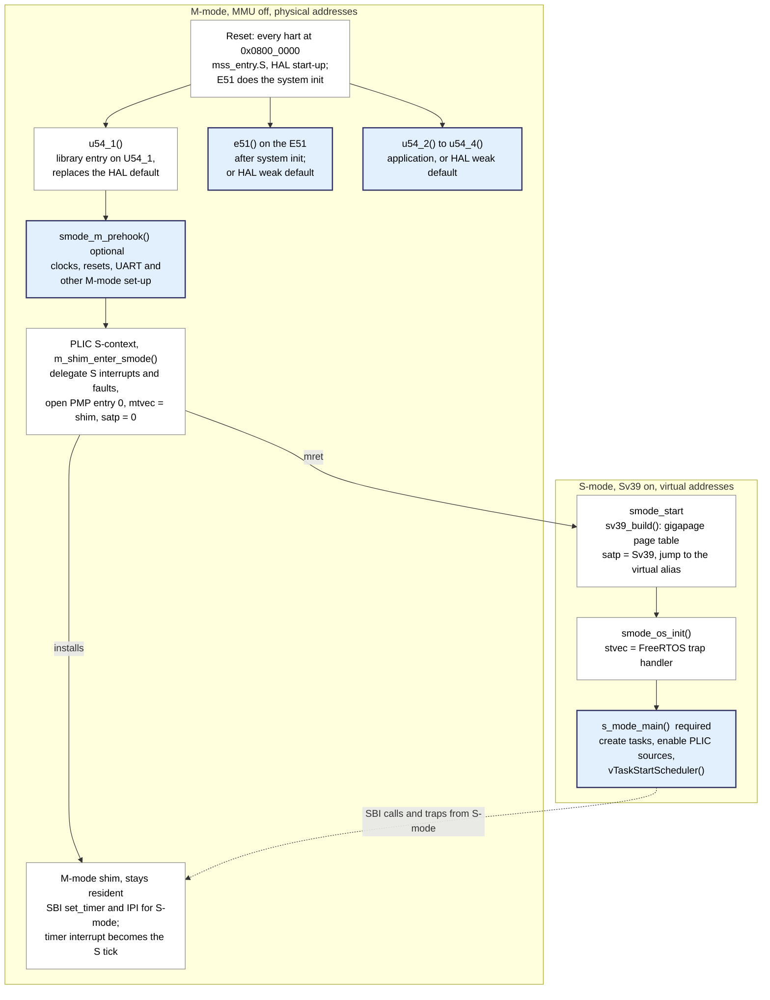

# Building the static libraries and a minimal U54 application

A review guide for the project's library build: how the static libraries
are built and installed, how an application links them to run FreeRTOS in
S-mode (supervisor mode) on U54_1 of the PolarFire SoC (MPFS), and a minimal
hello-world application. The diagrams are [Mermaid](https://mermaid.js.org/),
which GitHub renders inline.

## 1. Purpose and scope

This review covers how the static libraries are built and how an application
links them. It ends with a minimal hello-world application, so reviewers can
check that the library interface is small enough to start from.

In scope:

- the library build (make and CMake) and its installed layout;
- the boot path from reset to the application's entry function;
- the files an application must provide, and which settings belong to the
  library versus the application.

Out of scope: the demo's simulated peripherals and the Renode test set-up,
except for running the hello-world.

## 2. The libraries

The build produces four static libraries and an install tree. An application
links the first two and needs nothing else from the project's sources.

| Library | Contents | Who links it |
| --- | --- | --- |
| `libmpfs_smode_boot.a` | MPFS HAL start-up (`mss_entry.S`, PLIC/CLINT/PMP/L2), `u54_1()`, the M-mode SBI shim, Sv39 bring-up, `smode_start`, diagnostics | every application |
| `libfreertos_smode.a` | FreeRTOS kernel, `heap_4`, the S-mode port, PLIC dispatch, fault reporting, FreeRTOS hooks, `smode_os_init()` | every application |
| `libmpfs_drivers.a` | MSS drivers listed in `MPFS_DRIVERS` (default `mss_mmuart`, `mss_gpio`, `mss_spi`, `mss_i2c`) | applications that use those drivers |
| `libfreertos_tcp.a` | FreeRTOS+TCP V4.4.2 (IPv4) and the LiteEth soft-MAC network interface | networked applications only |

The libraries only take care of U54_1. The E51 and U54_2 to U54_4 run the
application's `e51()` and `u54_2()` to `u54_4()`, or the HAL's weak defaults.

Some settings are compiled into the libraries (marked `LIBRARY-FIXED` in the
sources). Changing one means rebuilding the libraries. Setting it differently
in an application has no effect, or stops the build where it is enforced.

| Setting | Level |
| --- | --- |
| `FreeRTOSConfig.h` (tick, priorities, heap, port options) | library-fixed |
| `FreeRTOSIPConfig.h` (IP options, LiteEth addresses) | library-fixed |
| Boot mode: `LOADED_BY_BOOTLOADER`, `MPFS_HAL_FIRST_HART`, `MPFS_HAL_LAST_HART` | library-fixed, enforced |
| `MARCH`, `LIBC_SPECS`, ABI options | library-fixed, enforced |
| Board configuration (`MPFS_BOARD_DIR`), S-mode hart = U54_1, M-mode shim, Sv39 mapping policy | library-fixed |
| `s_mode_main()`, `smode_m_prehook()`, `smode_diag_puts()`, PLIC handlers, other harts' entry functions | application |
| Linker script and DDR layout, build type, compiler path | application (defaults to the libraries') |

"Enforced" means the application build files (`mpfs_smode.mk`,
`MpfsSmodeConfig.cmake`) read the value from the install tree. If the
application asks for a different one, the build stops.

## 3. Toolchain and prerequisites

Everything needed ships with SoftConsole v2022.2; CMake is the only optional
extra.

| Tool | Source | Notes |
| --- | --- | --- |
| `riscv64-unknown-elf-gcc` with newlib-nano | SoftConsole `riscv-unknown-elf-gcc\bin` | a picolibc toolchain also works: `LIBC_SPECS=--specs=picolibc.specs LIBC_LINK_SPECS=` |
| GNU `make`, `sh`, `busybox` | SoftConsole `build_tools\bin` | must be first on PATH in a plain shell, or make falls back to `cmd.exe` and stops |
| CMake 3.24 or later, Ninja | installed separately | optional; the same libraries and install tree as make |
| Renode 1.13 | SoftConsole `renode` | only to run the hello-world without a board |

Compile options used for the libraries and every application:
`-march=rv64gc -mabi=lp64d -mcmodel=medany -mstrict-align -fno-jump-tables
-ffunction-sections -fdata-sections` (`rv64gc_zicsr_zifencei` on GCC 12 or
later). Link options: `-nostartfiles -Wl,--gc-sections -T mpfs-lim-sv39.ld`.

On Windows, from PowerShell:

```powershell
$env:PATH = "C:\Microchip\SoftConsole-v2022.2-RISC-V-747\build_tools\bin;C:\Microchip\SoftConsole-v2022.2-RISC-V-747\riscv-unknown-elf-gcc\bin;$env:PATH"
```

## 4. Building the libraries

One command builds the libraries and installs them into a self-contained
tree. Applications are then built only against that tree, never against
`src/`.

The build is split into three roles, each with a Makefile and a
CMakeLists.txt:

| Role | make | CMake | Knows about |
| --- | --- | --- | --- |
| Library | `src/Makefile` | `src/CMakeLists.txt` | only `src/` |
| Application | `examples/freertos-demo/Makefile` | `examples/freertos-demo/CMakeLists.txt` | only an install tree |
| Orchestrator (what SoftConsole runs) | `Makefile` | `CMakeLists.txt` | both; picks the `FreeRTOSConfig.h` the libraries get |

### 4.1 With make

```sh
make -C src                                    # libraries, reference FreeRTOSConfig.h
make -C src install PREFIX=C:/mpfs-smode       # install tree
make -C src FREERTOS_CONFIG_DIR=<dir> install PREFIX=C:/mpfs-smode   # your FreeRTOSConfig.h
make -C src BUILD_TYPE=Release install PREFIX=C:/mpfs-smode          # -Os -g instead of -O0 -g3
```

Changing any library setting rebuilds the libraries from scratch on the next
`make`; no `make clean` is needed. The install tree records the settings in
`mk/build_config.mk`.

### 4.2 With CMake

```sh
cmake -S src -B build-lib -G Ninja
cmake --build build-lib
cmake --install build-lib --prefix C:/mpfs-smode
```

Cache variables have the same names as the make variables
(`FREERTOS_CONFIG_DIR`, `LOADED_BY_BOOTLOADER`, `MPFS_DRIVERS`, ...), with
`CMAKE_BUILD_TYPE` in place of `BUILD_TYPE`. The project root also has
presets (`debug`, `release`) for the library plus the demo.

### 4.3 The install tree

make and CMake install the same files, and either tree serves both kinds of
application.

```
C:/mpfs-smode/
  lib/libmpfs_smode_boot.a, libfreertos_smode.a, libmpfs_drivers.a, libfreertos_tcp.a
  lib/ldscripts/mpfs-lim-sv39.ld       linker script: L2LIM code + Sv39 DDR window
  lib/cmake/MpfsSmode/                 find_package(MpfsSmode) for CMake applications
  include/                             mpfs_hal/, hal/, drivers/, smode/ (mpfs_smode.h), board config
  include/freertos/                    kernel + port headers, the FreeRTOSConfig.h the library was built with
  include/freertos_tcp/                FreeRTOS+TCP headers, the FreeRTOSIPConfig.h used
  mpfs_smode.mk                        for application Makefiles
  mk/toolchain.mk, mk/build_config.mk  compiler options and the recorded library settings
```

## 5. Boot flow: reset to the application entry

The library owns the whole path from reset to `s_mode_main()`. The
application only adds the optional M-mode pre-hook and the entry function.
[`boot-to-smode.md`](boot-to-smode.md) has the full detail.



Blue boxes are application code; white boxes are the library.

After the hand-over, M-mode on U54_1 only runs for traps from S-mode:
- the SBI timer and IPI calls;
- the machine timer interrupt, forwarded as the FreeRTOS tick;
- anything unexpected, which is reported through `smode_diag_puts()` before
  the hart parks.

With `LOADED_BY_BOOTLOADER=1` the E51 system init is skipped and a
bootloader such as HSS starts U54_1, but the path from `u54_1()` onwards is
the same.

## 6. A minimal application: hello-world on U54_1

A complete application is two C files and one build file: `s_mode_main()` is
the entry, and everything else is optional. The example project below is not
in this repository; it was built with both make and CMake against an
installed library tree and run in Renode (section 7).

```
hello/
  main.c           S-mode: s_mode_main() and one FreeRTOS task
  m_mode.c         M-mode: U54_1 pre-hook, diagnostic output, parking the other harts
  Makefile         make build, or
  CMakeLists.txt   CMake build
```

There is no `FreeRTOSConfig.h`, linker script or start-up code in the
project. All three come from the install tree, matching what the libraries
were built with.

### 6.1 What the application provides

| Symbol | Required | Runs in | Purpose |
| --- | --- | --- | --- |
| `s_mode_main()` | yes | S-mode, MMU on, virtual addresses, interrupts off | create tasks, enable PLIC sources, start the scheduler |
| `smode_m_prehook()` | no (weak, empty) | M-mode on U54_1, MMU off | clocks, resets and peripheral set-up that needs M-mode |
| `smode_diag_puts()` | no (weak, discards) | M- and S-mode, interrupts off | output for library fault, assert and shim reports; must be polled |
| `e51()`, `u54_2()` to `u54_4()` | no (HAL weak defaults) | M-mode on the other harts | standalone boot only; the defaults jump to the boot-ROM park loop in eNVM, which is empty in Renode |

### 6.2 main.c (S-mode)

```c
/* S-mode application: entered by the library on U54_1 with the MMU on. */
#include <stdio.h>

#include "FreeRTOS.h"
#include "task.h"
#include "drivers/mss/mss_mmuart/mss_uart.h"
#include "smode/mpfs_smode.h"

static void hello_task(void *arg)
{
    char line[64];
    unsigned n = 0U;

    (void)arg;
    for (;;)
    {
        snprintf(line, sizeof line, "[S] hello from U54_1 #%u\r\n", n++);
        MSS_UART_polled_tx_string(&g_mss_uart1_lo, (const uint8_t *)line);
        vTaskDelay(pdMS_TO_TICKS(1000));
    }
}

void s_mode_main(void)
{
    xTaskCreate(hello_task, "hello", configMINIMAL_STACK_SIZE * 2U, NULL,
                tskIDLE_PRIORITY + 1U, NULL);
    vTaskStartScheduler();      /* does not return */
    for (;;) { }
}
```

### 6.3 m_mode.c (M-mode)

```c
/* M-mode parts: U54_1's pre-hook, the library's diagnostic output, and the
 * harts the libraries do not use. Built with the library's options. */
#include "mpfs_hal/mss_hal.h"
#include "drivers/mss/mss_mmuart/mss_uart.h"
#include "smode/mpfs_smode.h"

/* U54_1, M-mode, MMU off: clocks/resets and the UART used from S-mode. */
void smode_m_prehook(void)
{
    (void)mss_config_clk_rst(MSS_PERIPH_MMUART1, (uint8_t)MPFS_HAL_FIRST_HART, PERIPHERAL_ON);
    MSS_UART_init(&g_mss_uart1_lo, MSS_UART_115200_BAUD,
                  MSS_UART_DATA_8_BITS | MSS_UART_NO_PARITY | MSS_UART_ONE_STOP_BIT);
    MSS_UART_polled_tx_string(&g_mss_uart1_lo, (const uint8_t *)"[M] U54_1 pre-hook done\r\n");
}

/* Library fault, assert and shim reports (M- and S-mode, polled). */
void smode_diag_puts(const char *s)
{
    MSS_UART_polled_tx_string(&g_mss_uart1_lo, (const uint8_t *)s);
}

/* E51 and U54_2..4: park in WFI (the HAL's weak defaults jump into eNVM). */
static void park(void)
{
    write_csr(mie, 0U);
    for (;;) { __asm volatile ("wfi"); }
}

void e51(void)   { park(); }
void u54_2(void) { park(); }
void u54_3(void) { park(); }
void u54_4(void) { park(); }
```

The UART is reached at the same address from both modes. The library's Sv39
table identity-maps the first gigabyte (MSS peripherals) and the fabric
window, and `&g_mss_uart1_lo` is computed PC-relative.

### 6.4 Makefile

```make
# The libraries' install prefix (make -C src install PREFIX=...).
MPFS_SMODE_DIR ?= C:/mpfs-smode
include $(MPFS_SMODE_DIR)/mpfs_smode.mk

OBJS := build/main.o build/m_mode.o

build/hello.elf: $(OBJS) $(MPFS_SMODE_DEPS)
	$(CC) $(MPFS_SMODE_LDFLAGS) $(OBJS) $(MPFS_SMODE_LIBS) -o $@
	$(SIZE) $@

build/%.o: %.c $(MPFS_SMODE_CONFIG)
	@mkdir -p $(@D)
	$(CC) $(MPFS_SMODE_CFLAGS) -Wall -Wextra -c $< -o $@

clean:
	rm -rf build
```

`mpfs_smode.mk` supplies:
- the compiler;
- the compile flags and include paths (`MPFS_SMODE_CFLAGS`);
- the link flags and linker script (`MPFS_SMODE_LDFLAGS`);
- the libraries in link order (`MPFS_SMODE_LIBS`).

The boot and FreeRTOS libraries are linked with `--whole-archive`, because
their strong definitions (`u54_1()`, `smode_os_init()`) must override HAL
weak symbols. Objects depend on `MPFS_SMODE_CONFIG`, so they rebuild when the
libraries' settings change.

### 6.5 CMakeLists.txt

```cmake
cmake_minimum_required(VERSION 3.24)
project(hello LANGUAGES C ASM)

find_package(MpfsSmode REQUIRED)

add_executable(hello main.c m_mode.c)
set_target_properties(hello PROPERTIES SUFFIX ".elf")
target_compile_options(hello PRIVATE -Wall -Wextra)
target_link_libraries(hello PRIVATE MpfsSmode::mpfs_smode MpfsSmode::mpfs_drivers)
```

`MpfsSmode::mpfs_smode` carries the same options, include paths, linker
script and whole-archive linking as `mpfs_smode.mk`. The toolchain file is
installed with the package, and library-fixed settings such as `LIBC_SPECS`
come from the install tree, so none need passing.

The example uses the library's reference `FreeRTOSConfig.h`:
- 1000 Hz tick;
- 5 priorities;
- a 32 KiB `heap_4` heap in L2LIM;
- yield through an SBI IPI.

An application that needs different values rebuilds the libraries with its
own file (`FREERTOS_CONFIG_DIR`).

## 7. Building and running the hello-world

Both builds produce an ELF with 39.7 KB of code (text) that prints one line
per second on MMUART1 in Renode's stock PolarFire SoC platform. No DDR or
simulated peripherals are needed.

1. Build and install the libraries once:

    ```sh
    make -C src install PREFIX=C:/mpfs-smode
    ```

2. Build the application, with make:

    ```sh
    make -C hello MPFS_SMODE_DIR=C:/mpfs-smode
    ```

    or with CMake:

    ```sh
    cmake -S hello -B build-hello -G Ninja ^
          -DCMAKE_TOOLCHAIN_FILE=C:/mpfs-smode/lib/cmake/MpfsSmode/riscv64-unknown-elf.cmake ^
          -DCMAKE_PREFIX_PATH=C:/mpfs-smode
    cmake --build build-hello
    ```

3. Run it in Renode. Every hart starts at the physical reset vector
   `0x08000000`, as the debug launchers do:

    ```
    mach create "hello"
    machine LoadPlatformDescription @platforms/cpus/polarfire-soc.repl
    sysbus LoadELF @C:/work/hello/build/hello.elf
    sysbus.e51 PC 0x08000000
    sysbus.u54_1 PC 0x08000000
    sysbus.u54_2 PC 0x08000000
    sysbus.u54_3 PC 0x08000000
    sysbus.u54_4 PC 0x08000000
    showAnalyzer sysbus.mmuart1
    start
    ```

Expected on MMUART1, after 3 emulated seconds:

```
[M] U54_1 pre-hook done
[S] hello from U54_1 #0
[S] hello from U54_1 #1
[S] hello from U54_1 #2
```

The first line comes from M-mode before the hand-over. The others come from
a FreeRTOS task in S-mode, paced by the S-mode timer tick that the M-mode
shim forwards.

To debug it, use the project's existing SoftConsole launcher or VS Code
configurations with the ELF path changed. Break at `s_mode_main`, the first
S-mode code with symbols at their virtual addresses.

## 8. Review checklist and open questions

### Build

- Is the split into library, application and orchestrator builds right? An
  application should never need `src/`.
- Is the library-fixed list complete? Nothing an application may reasonably
  change should be baked in.
- Is enforcing `MARCH`, `LIBC_SPECS` and the boot mode from the install tree
  the right behaviour? The build stops on a mismatch.
- The source lists for the boot, glue and kernel code are duplicated in
  `src/Makefile` and `src/CMakeLists.txt`. Is that acceptable, or should one
  be generated from the other?
- Is whole-archive linking of the boot and FreeRTOS libraries acceptable? It
  relies on `--gc-sections` to drop unused code.

### Application interface

- Is `s_mode_main()` as the only required symbol, with the three optional
  weak hooks, the interface we want to support?
- Code in `smode_m_prehook()` runs in M-mode with the MMU off, and anything it
  calls must be built with the library's options. Is that constraint clear
  enough for application authors?
- Other harts: the HAL's weak `e51()` and `u54_2()` to `u54_4()` jump into
  eNVM. Should the library park them in WFI by default, instead of every
  application doing it?

### Hardware versus Renode

- `configPORT_YIELD_VIA_SBI_IPI` is 1 because Renode 1.13 ignores S-mode
  writes to `sip`, and it must be 0 on hardware. Should hardware be the
  default, with Renode builds opting in?
- Only standalone boot (`LOADED_BY_BOOTLOADER=0`) has been run. The
  HSS-loaded mode is built but not tested.
- Code runs from L2LIM: the demo's Debug build uses about 245 of 255 KiB.
  Larger applications need a Release build or code in DDR, which is not
  provided.
