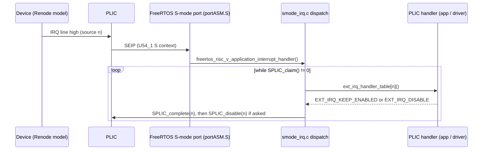
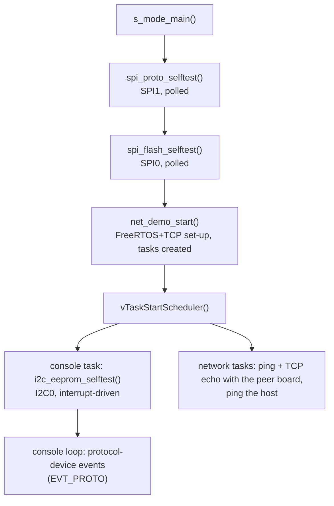

# Peripheral samples

Each simulated peripheral of the demo has its own document. It covers:
- the C code that talks to the device, with the registers it uses;
- the task and interrupt flows;
- the Renode side: which files describe the device, and any C# written for
  it.

| Document | Device | Bus / window | Interrupt | Firmware | Renode |
|---|---|---|---|---|---|
| [spi-nor-flash.md](spi-nor-flash.md) | Serial NOR flash, 16 MiB | MSS SPI0 | none (polled) | `spi_flash.c`, `spi_xfer.c` | `NorFlash.cs` (custom) on the built-in `MPFS_SPI` |
| [spi-protocol-device.md](spi-protocol-device.md) | Example request/response device with a register file and events | MSS SPI1 | data-ready → PLIC 119 (F2M_1) | `proto_dev.c`, `spi_xfer.c` | `ProtoSpiDevice.cs` (custom) |
| [i2c-eeprom.md](i2c-eeprom.md) | AT24C256-like EEPROM, 32 KiB | MSS I2C0 | I2C0 → PLIC 58 | `i2c_eeprom.c` on the vendor `MSS_I2C` driver | `I2cEeprom.cs` + `MpfsI2c.cs` (custom controller replacing Renode's) |
| [ethernet-liteeth.md](ethernet-liteeth.md) | LiteEth soft MAC + PHY, FreeRTOS+TCP, host bridge | fabric FIC3 `0x4000_0000` | LiteEth → PLIC 120 (F2M_2) | `src/freertos_tcp/*` (library), `net_demo.c` | built-in `LiteX_Ethernet` + PHY; `SocketBridge.cs` + `host_bridge.py` (custom) |

## What all of them share

**Where the code runs.** Everything that talks to these devices runs on
U54_1 in **S-mode**, with the Sv39 MMU on:
- the self-tests in `s_mode_main()` before the scheduler;
- the console task;
- the network tasks.

M-mode code is involved in only two ways:
- the pre-hook (`examples/freertos-demo/m_prehook.c`) turns on clocks and
  takes the controllers out of reset (`mss_config_clk_rst()`, which reads
  `mhartid`, so it must run in M-mode);
- the M-mode shim forwards nothing for these devices: their interrupts go
  straight to U54_1's **S context** of the PLIC.

**S-mode HAL support.** Two vendor HAL areas were made S-mode aware (see
the README, "Limitations"), so the MSS drivers run from S-mode unchanged:
- the PLIC helpers in `src/platform/mpfs_hal/common/mss_plic.h`
  (`PLIC_EnableIRQ`, `PLIC_DisableIRQ`, ...);
- `HAL_disable_interrupts` / `HAL_restore_interrupts` in
  `src/platform/hal/hal_irq.c`.

Both switch to the S context / `sstatus.SIE` once the shim has set
`g_hal_smode_active`.

**Interrupt path** (every device with an interrupt):

The dispatch is in `src/freertos_glue/smode_irq.c`. `ext_irq_handler_table`
is the HAL's table (`src/platform/mpfs_hal/common/mss_mtrap.c`), so the
usual handler names work, e.g. `fabric_f2h_1_plic_IRQHandler` or the vendor
I2C driver's `PLIC_External_i2c0_main_IRQHandler`. A source is enabled for
the S context with `PLIC_SetPriority()` + `SPLIC_enable()`
(`src/smode/smode_plic.h`); the demo does that for its sources in
`s_mode_main()` (`examples/freertos-demo/app_main.c`, `g_smode_irqs[]`).

**Level-triggered sources** (the protocol device and the MAC) follow one
pattern:
1. The handler wakes a task and returns `EXT_IRQ_DISABLE`.
2. The task services the device until the line drops.
3. The task calls `SPLIC_enable()` again.

The PLIC re-latches a line that is still high when the interrupt is
completed. So re-enabling delivers one more interrupt, which then finds
nothing to do; both users ignore that.

**Order of the self-tests** (UART1 shows each step):

**Renode files common to all:**

| File | Role |
|---|---|
| `renode/mpfs-sim-peripherals.repl` | Attaches every device below to the platform (and replaces `i2c0`) |
| `renode/models/*.cs` | The custom C# models, compiled by Renode when `include`d |
| `mpfs-freertos-smode Renode All-harts Debug.launch` | SoftConsole: includes the models, unregisters the built-in `i2c0`, loads the repl, sets the MAC |
| `renode/boards.resc`, `run-demo.resc`, `run-host.resc` | Headless two-board runs (`make sim`, `make sim-host`, CTest) |
| `renode/expected-*.txt`, `check-uart.sh`, `cmake/*.cmake` | The PASS/FAIL checks |
| `renode/tests/mpfs-demo.robot` | Robot Framework tests |

`renode/README.md` describes running and testing; the documents here
describe the devices.
