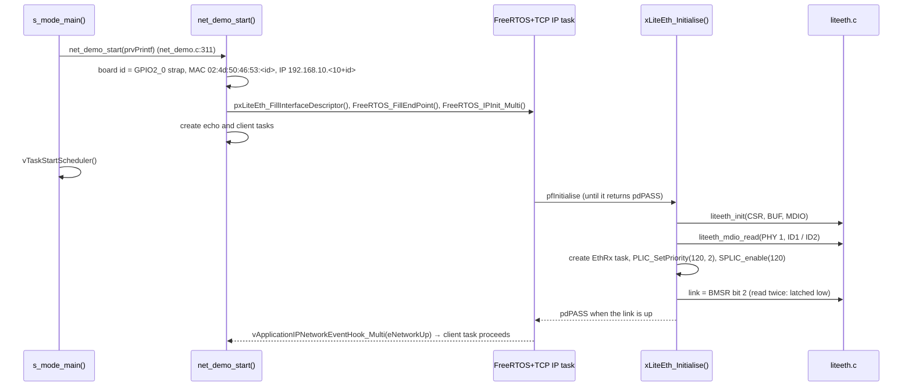
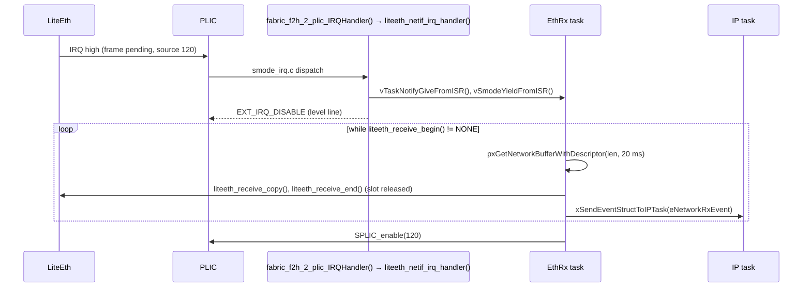
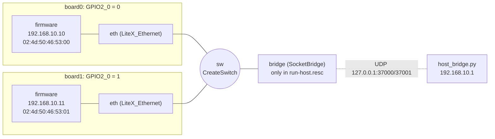

# Ethernet: LiteEth soft MAC, FreeRTOS+TCP and the host bridge

A soft Ethernet MAC in the FPGA fabric (LiteEth, behind FIC3) with a PHY on
its MDIO bus, driven by **FreeRTOS+TCP** through a network interface in the
`libfreertos_tcp.a` library. The demo:
- gives each board a static IP;
- runs a TCP echo server;
- pings the other board and runs a TCP echo with it;
- pings the host PC when the user-mode host bridge is attached.

| | |
|---|---|
| MAC | LiteEth: CSRs `0x4000_0000`, MDIO `0x4000_1000`, slot buffers `0x4001_0000` (fabric FIC3) |
| PHY | MDIO address 1 (Renode: IDs `0022:1561`, link up) |
| Interrupt | LiteEth → fabric line F2M_2 → **PLIC 120**, level, S context |
| Mapping | the library's Sv39 table identity-maps gigapage 1 (`0x4000_0000`–`0x7FFF_FFFF`, RW, no X) |
| Library | `src/freertos_tcp/liteeth.c/.h` (driver), `src/freertos_tcp/NetworkInterface_LiteEth.c/.h` (FreeRTOS+TCP interface), FreeRTOS+TCP V4.4.2 in `src/middleware/FreeRTOS-Plus-TCP/` |
| Configuration | `FreeRTOSIPConfig.h` (LIBRARY-FIXED; the demo's is `examples/freertos-demo/FreeRTOSIPConfig.h`) |
| Demo | `examples/freertos-demo/net_demo.c/.h`; the IRQ hook in `app_main.c:212` |
| Result lines | `[S] NET: ping board <n>: PASS`, `[S] NET: TCP echo with board <n>: PASS`, with the bridge `[S] NET: ping host 192.168.10.1: PASS` |

## 1. Hardware view

### 1.1 Address map and Sv39

The MAC is in the fabric window behind FIC3. `src/smode/sv39.c` maps
physical gigapage 1 one-to-one for S-mode (`SV39_FABRIC_PA`, RW, not
executable), so the driver uses the physical addresses directly. No DMA is
involved: frames are copied by the CPU through the MAC's slot buffers. So
the Sv39 addresses of network buffers in DDR never reach the hardware.

The M-mode pre-hook turns on FIC3's clock and reset
(`mss_config_clk_rst(MSS_PERIPH_FIC3, …)`). On hardware the fabric
interrupt F2M_2 must also be wired to the MAC's IRQ in the Libero design.

### 1.2 LiteEth registers (`liteeth.c`)

**CSRs**, base `0x4000_0000`. The old LiteX layout: 8-bit subregisters at
a 4-byte stride, multi-byte values MSB first. `csr_read_multi()` /
`csr_write_multi()` (`liteeth.c:60`, `:71`) assemble them.

| CSR | Offset | Side | Use |
|---|---|---|---|
| `WriterSlot` | 0x00 | RX | slot holding the received frame; **reading latches it** |
| `WriterLength` | 0x04–0x10 | RX | 32-bit length of that frame (4 subregisters) |
| `WriterEvPending` | 0x28 | RX | bit 0: a frame is pending; **write 1: release the latched slot** |
| `WriterEvEnable` | 0x2C | RX | bit 0: interrupt on received frames (set in `liteeth_init()`) |
| `ReaderStart` | 0x30 | TX | write 1: send the selected slot |
| `ReaderReady` | 0x34 | TX | bit 0: transmitter ready |
| `ReaderSlot` | 0x3C | TX | TX slot to send |
| `ReaderLength` | 0x40/0x44 | TX | 16-bit length (2 subregisters) |
| `ReaderEvPending` | 0x4C | TX | "sent" event; cleared, not used |
| `ReaderEvEnable` | 0x50 | TX | 0: no TX interrupt |

**Buffers**, base `0x4001_0000`, 32-bit accesses: RX slots 0–1 at
`+0x0000` / `+0x0800`, TX slots 0–1 at `+0x1000` / `+0x1800`.

**MDIO**, base `0x4000_1000`, bit-banged:

| Register | Offset | Bits |
|---|---|---|
| W | 0x04 | bit 0 MDC (clock), bit 1 OE (master drives MDIO), bit 2 MDIO out |
| R | 0x08 | bit 0 MDIO in |

### 1.3 Driver functions (`liteeth.c`)

| Function | Line | What |
|---|---|---|
| `liteeth_init()` | 79 | Writes 1 to `WriterEvPending` with no slot latched, which releases all RX slots; clears the reader event; `ReaderEvEnable` = 0, `WriterEvEnable` = 1 |
| `liteeth_send()` | 95 | Waits for `ReaderReady` (bounded); pads to 60 bytes; copies the frame word by word into TX slot n, alternating 0 / 1; `ReaderSlot`, `ReaderLength`, `ReaderStart` = 1. The MAC appends the FCS |
| `liteeth_receive_begin()` | 136 | `WriterEvPending` = 0 → `LITEETH_NONE`; else reads `WriterSlot` (latch) and `WriterLength` |
| `liteeth_receive_copy()` | 157 | Copies up to the length from the slot, word by word |
| `liteeth_receive_end()` | 174 | `WriterEvPending` = 1: releases the slot (always called after a successful begin) |
| `liteeth_mdio_read()` | 242 | Clause 22 read: 32 × `1` preamble, start `01`, opcode `10`, PHY and register address (MSB first), 2 released turnaround clocks, 16 data bits read after rising MDC edges |
| `liteeth_mdio_write()` | 259 | Clause 22 write (opcode `01`, turnaround `10`, 16 data bits). Not used by the interface |

Receiving is split in three steps so that the caller can size its buffer
(a FreeRTOS+TCP network buffer) between them.

## 2. FreeRTOS+TCP network interface (`NetworkInterface_LiteEth.c`)

### 2.1 Tasks and priorities

| Task | Priority | Stack | Role |
|---|---|---|---|
| IP task (FreeRTOS+TCP) | `configMAX_PRIORITIES - 2` = 3 | `configMINIMAL_STACK_SIZE * 8` | the stack; calls the interface's initialise, output and link-status functions |
| `EthRx` (`prvRxTask`, line 104) | `configMAX_PRIORITIES - 1` = 4 | `configMINIMAL_STACK_SIZE * 4` | moves received frames from the MAC to the IP task |
| `echo` (`vEchoServerTask`, `net_demo.c:107`) | 2 | `configMINIMAL_STACK_SIZE * 4` | TCP echo server, port 7 |
| `client` (`vClientTask`, `net_demo.c:255`) | 2 | `configMINIMAL_STACK_SIZE * 4` | ping peer → TCP echo → ping host, then deletes itself |

Network buffers (`BufferAllocation_2`) and every task stack come from the
FreeRTOS heap. In the demo that heap is 4 MiB in DDR:
- `configAPPLICATION_ALLOCATED_HEAP`, with `ucHeap` placed by
  `examples/freertos-demo/ddr_buffers.ld`;
- it lives at buf0 + 16 MiB, virtual address `0xFFFFFFC0_41000000`.

### 2.2 Initialisation



Without a PHY (ID `0` or `0xFFFFFFFF`) the link is assumed up.

### 2.3 Receive path



- **Wake-ups without an interrupt:** the task also wakes every 100 ms
  (`RX_POLL_TICKS`), so a lost edge cannot stall reception.
- **No buffer:** a frame with no network buffer is released and counted
  (`rx_no_buffer`).
- **Length:** the frame length passed up is the MAC's (with FCS, plus the
  Renode padding quirk, section 3.2). FreeRTOS+TCP takes lengths from the
  IP and ARP headers, so trailing bytes do no harm.

### 2.4 Transmit path

`xLiteEth_Output()` (line 196) runs in the IP task: `liteeth_send()` of
the buffer, then releases it if asked. Checksums are computed in software
(`ipconfigDRIVER_INCLUDED_*_CHECKSUM` = 0).

### 2.5 Board settings (`FreeRTOSIPConfig.h`)

| Setting | Demo value |
|---|---|
| `ipconfigLITEETH_CSR_BASE` / `_BUF_BASE` / `_MDIO_BASE` | `0x40000000` / `0x40010000` / `0x40001000` |
| `ipconfigLITEETH_PHY_ADDR` | 1 |
| `ipconfigLITEETH_PLIC_IRQ` | 120 (F2M_2) |
| IP options | IPv4 only; no DHCP / DNS; TCP with windows; ping replies and outgoing pings; 32 network buffers; MTU 1500 |

The application routes the PLIC source to the interface. That is the only
hook it needs:

```c
uint8_t fabric_f2h_2_plic_IRQHandler(void) { return liteeth_netif_irq_handler(); }
```

## 3. Renode simulation

### 3.1 Files

| File | What |
|---|---|
| `renode/mpfs-sim-peripherals.repl` | `eth: Network.LiteX_Ethernet @ { sysbus 0x40000000; …"buffer" at 0x40010000; …"phy" at 0x40001000 }`, `IRQ -> plic@120`; `ethphy: Network.EthernetPhysicalLayer @ eth 1` with `Id1: 0x0022`, `Id2: 0x1561` |
| Debug launcher, `renode/boards.resc` | `sysbus.eth MAC "02:4d:50:46:53:<id>"` (a repl cannot set a `MACAddress`) |
| `renode/boards.resc` | Two boards (`board0`, `board1`), same ELF, on `emulation CreateSwitch "sw"` (`connector Connect sysbus.eth sw`); board 1 gets the GPIO2_0 strap (`sysbus WriteDoubleWord 0x20122000 0x2` to make it an input, then `sysbus.gpio2 OnGPIO 0 true`) |
| `renode/expected-uart.txt` | Requires `NET: ping board` and `NET: TCP echo with board` on both boards |
| `renode/models/SocketBridge.cs`, `renode/host-bridge.repl`, `renode/run-host.resc`, `renode/host_bridge.py` | The host bridge (section 4) |

### 3.2 The built-in models (not modified)

**`LiteX_Ethernet`** (Renode 1.13) implements exactly the register map in
section 1.2. Behaviour the driver relies on, or works around:
- **RX slots:** 2 (constructor default). A frame arriving while both are
  full is dropped ("There are no empty write slots"). In the TCP echo this
  happens about once a run, and TCP retransmits.
- **Received length:** includes the 4-byte FCS, plus `len % 60` extra zero
  bytes (a padding bug). Hence "take the length from the payload".
- **TX:** the frame is sent with an FCS appended. Frames of at least 60
  bytes are sent, because the driver pads.
- **MDIO:** decoded by a bit-bang helper (MDC = bit 0, data = bit 2 of the
  W register).
  - The command word is decoded LSB first, while read data comes back MSB
    first after the turnaround. Together that matches a standard clause 22
    read, which is what `liteeth_mdio_read()` sends.
  - Writes reach the PHY bit-reversed, a model bug. The interface only
    reads.

**`EthernetPhysicalLayer`** answers clause 22 reads: ID registers from its
`Id1` / `Id2` properties, and BMSR with link up and auto-negotiation
complete.

**The switch** is a learning switch. It remembers which interface each
*source* MAC came from, sends frames for a known destination only there,
and floods the rest. The MAC model's own `MAC` property does not affect
delivery. It is set anyway so that the switch log names the boards.

### 3.3 Two boards



Both boards run the same program. Each one's client pings the other, then
connects to the other's echo server and sends 4 KiB
(`tcp_echo()`, `net_demo.c:179`). Both sides print PASS:

```
[S] NET: board 0, FreeRTOS+TCP on LiteEth, 192.168.10.10, peer 192.168.10.11
[S] NET: up: 192.168.10.10/24, MAC 02:4d:50:46:53:00, PHY id 0x00221561, link up
[S] NET: ping board 1: PASS (0 ms)
[S] NET: echo server: client 192.168.10.11 done, 4096 bytes echoed
[S] NET: TCP echo with board 1: PASS (4096 bytes, 16 ms; MAC tx 24, rx 24, dropped 0)
[S] NET: no reply from host 192.168.10.1 (no host bridge)
```

With a single board (the SoftConsole launcher) the client prints `no reply
from board 1 … (single board?)`, which is not a failure.

## 4. Host bridge (custom C# and Python)

The aim is to put the host PC on the simulated network **without a TAP
device or administrator rights**.

### 4.1 `SocketBridge.cs`

`Antmicro.Renode.Peripherals.Network.SocketBridge : IMACInterface,
IDoubleWordPeripheral, IKnownSize, IDisposable`, about 135 lines.
- **Registration:** it is registered on board 0's bus at `0x4000_2000`
  (`renode/host-bridge.repl`) only so that a repl can create it and
  `connector Connect sysbus.bridge sw` can attach it. Its two registers
  are frame counters.

| Member | Line | Role |
|---|---|---|
| constructor | 36 | Binds a UDP socket on `127.0.0.1:localPort` (default 37001), starts the receive thread; MAC `02:4d:50:46:53:fe` |
| `ReceiveFrame()` | 49 | A frame from the switch → one UDP datagram to `127.0.0.1:remotePort` (37000), FCS stripped |
| `ReceiveLoop()` | 101 | Datagrams from the host → `EthernetFrame` (FCS added) → `FrameReady` → the switch |
| `FramesToHost`, `FramesFromHost` | | counters (monitor, and registers 0x0 / 0x4) |
| `Dispose()` | 85 | Stops the thread and closes the socket when Renode quits |

### 4.2 `host_bridge.py`

Python 3, standard library only. It is `192.168.10.1` (MAC
`02:4d:50:46:53:fe`) on the simulated network:
- answers ARP requests and ICMP echo requests;
- echoes UDP datagrams to port 7;
- with `--ping <ip>`, ARPs and pings that board every second until it
  answers.

Every event is logged, and with `--report` also written to a file, which
`make sim-host` / CTest `sim_host` check against
`renode/expected-host.txt`.

| Option | Use |
|---|---|
| `--listen-port` / `--send-port` | 37000 / 37001 (must match the repl) |
| `--duration S` | upper time limit |
| `--exit-idle S` | stop S seconds after the last frame (CTest) |
| `--quiet` | print nothing (CTest runs it in a pipe with Renode) |

The helper has no TCP; host programs cannot open sockets to the boards
through it.

## 5. Testing and findings

- **Covered by:**
  - `make sim` and CTest `sim` (both boards, ping + TCP echo);
  - `make sim-host` and CTest `sim_host` (plus the host pings both ways);
  - the Robot test "Should Ping And Echo Over TCP Between The Boards".
- **Negative check:** with board 1 disconnected from the switch, board 0
  reports no reply and the checks fail.
- **The MAC-matching mistake:** an early experiment suggested the switch
  needed the model MAC to match the firmware's. It had sent a unicast
  frame to an address that had never been a source. `make sim` passes
  without setting the MAC.
- **On hardware:** this needs a Libero design with LiteEth on FIC3, the
  IRQ on F2M_2 and a PHY at MDIO address 1, and trained DDR for the heap.
  None of it has run on hardware.
