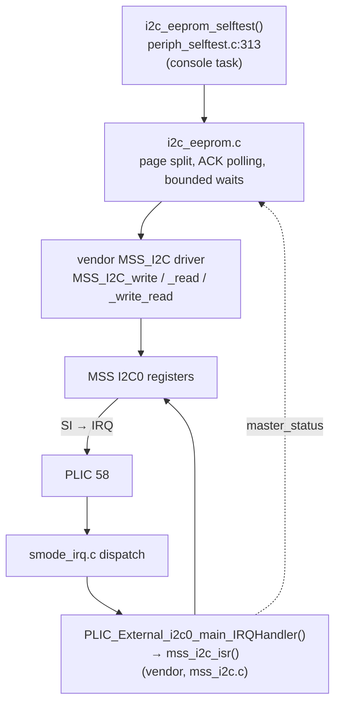
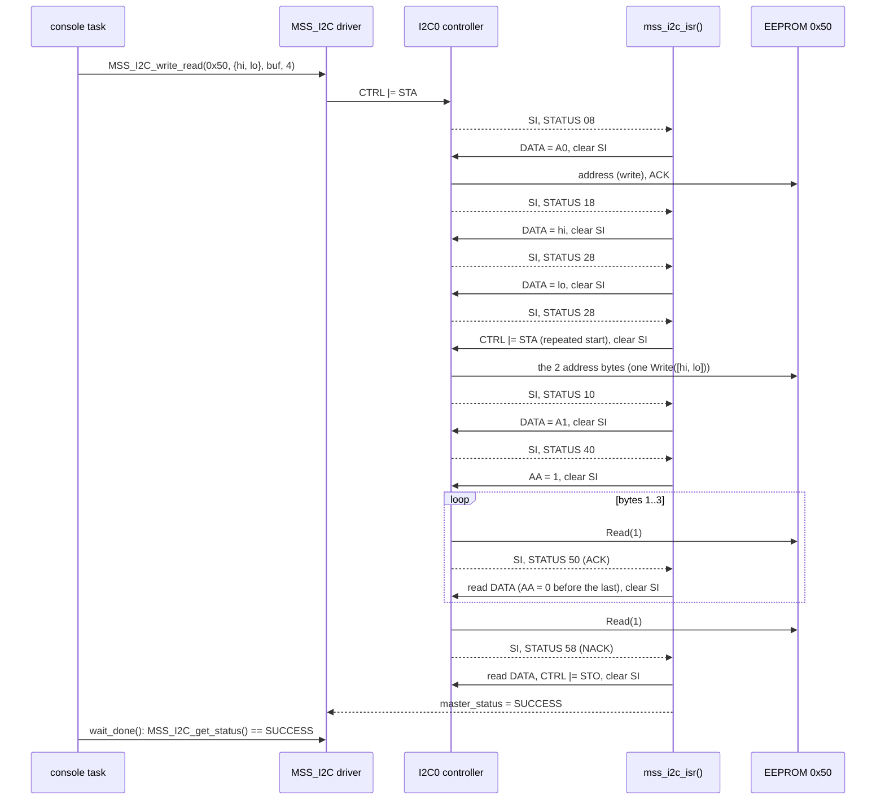

# I2C EEPROM (MSS I2C0)

An AT24C256-like EEPROM (32 KiB, 64-byte pages, 2-byte memory address) at
address `0x50` on MSS I2C0. Unlike the SPI samples, it is driven by the
**vendor `MSS_I2C` driver unchanged and interrupt-driven, from S-mode**.

The Renode side needed a **custom I2C controller model**:
- Renode 1.13's built-in `MPFS_I2C` cannot run an EEPROM with the vendor
  driver (section 3.2).
- Our `MpfsI2c.cs` replaces it on `i2c0`.

| | |
|---|---|
| Controller | MSS I2C0, `0x2010_A000` (`g_mss_i2c0_lo`), master, PCLK/256 |
| Device | `i2c0.eeprom` at `0x50`: `renode/models/I2cEeprom.cs`, behind `renode/models/MpfsI2c.cs` |
| Interrupt | I2C0 main → **PLIC 58** (`I2C0_MAIN_PLIC`), S context |
| Firmware | `examples/freertos-demo/i2c_eeprom.c/.h` on `src/platform/drivers/mss/mss_i2c/` |
| Self-test | `i2c_eeprom_selftest()` (`periph_selftest.c:313`), run by the **console task** (`app_main.c:241`) once the scheduler is running: the driver needs interrupts |
| Result line | `[S] I2C0 EEPROM (S-mode, MSS_I2C driver, interrupts): PASS` |

## 1. Firmware

### 1.1 Layers



### 1.2 Bring-up

- **M-mode pre-hook:** `mss_config_clk_rst(MSS_PERIPH_I2C0, …)` turns on
  the clock.
- **`eeprom_init()`** (`i2c_eeprom.c:94`):
  - **`MSS_I2C_init(&g_mss_i2c0_lo, 0x10, MSS_I2C_PCLK_DIV_256)`:**
    - `global_init()` pulses I2C0's soft reset in `SYSREG->SOFT_RESET_CR`
      (bit 12) and selects the PLIC source;
    - `CTRL.CR2..CR0` = the clock divider;
    - `ADDR` = our own address `0x10` (unused as a master);
    - `CTRL.ENS1` = 1.
  - **`PLIC_SetPriority(I2C0_MAIN_PLIC, 2)`, `SPLIC_enable(I2C0_MAIN_PLIC)`:**
    the source is enabled for U54_1's S context.
  - **Interrupts:** the driver also calls `PLIC_EnableIRQ()` /
    `PLIC_DisableIRQ()` itself, and masks interrupts with
    `HAL_disable_interrupts()`. Both are S-mode aware in this project.
  - **The ISR:** the driver's interrupt entry
    `PLIC_External_i2c0_main_IRQHandler()` (alias
    `External_i2c0_main_plic_IRQHandler`) fills the HAL's
    `ext_irq_handler_table[58]`. So the S-mode dispatch reaches it with no
    application code.

### 1.3 MSS I2C registers (CoreI2C)

Byte registers at a 4-byte stride (`I2C_TypeDef`, `mss_i2c.h`):

| Register | Offset | Used by | How |
|---|---|---|---|
| `CTRL` | 0x00 | driver | `CR2,CR1,CR0` (bits 7,1,0) clock; `ENS1` (6) enable; `STA` (5) start / repeated start; `STO` (4) stop; `SI` (3) interrupt flag, **cleared to let the hardware take the next step**; `AA` (2) ACK the next received byte |
| `STATUS` | 0x04 | ISR | state code (table below) |
| `DATA` | 0x08 | ISR | address byte (SLA+R/W) and data |
| `ADDR` | 0x0C | init | own slave address (not used as a slave) |
| `SMBUS`, `FREQ`, `GLITCHREG`, `SLAVE1_ADDR` | 0x10–0x1C | — | not used |

The master states the ISR (`mss_i2c_isr()`) acts on:

| STATUS | Meaning | ISR action |
|---|---|---|
| `08` / `10` | START / repeated START sent | clear `STA`, `DATA` = address + R/W |
| `18` / `28` | address / data sent, ACK | next byte to `DATA`; or `STA` (random read: change direction); or `STO`, `SUCCESS` |
| `20` / `30` | address / data sent, NACK | `STO`, `FAILED` |
| `40` | SLA+R sent, ACK | `AA` = 1 if more than one byte is wanted, else 0 |
| `48` | SLA+R sent, NACK | `STO`, `FAILED` |
| `50` | byte received, ACK sent | store it; clear `AA` before the last byte |
| `58` | byte received, NACK sent | store the last byte, `STO`, `SUCCESS` |

Every pass of the ISR ends by clearing `SI`. In this hardware model,
clearing `SI` is what starts the next bus action.

### 1.4 Driver calls (`i2c_eeprom.c`)

| Function | Line | Bus traffic |
|---|---|---|
| `eeprom_read()` | 103 | `MSS_I2C_write_read()`: START, `A0` (0x50 W), addr hi, addr lo, repeated START, `A1` (0x50 R), n bytes, STOP |
| `eeprom_read_current()` | 111 | `MSS_I2C_read()`: START, `A1`, n bytes, STOP (continues at the device's pointer) |
| `eeprom_write()` | 117 | split at 64-byte pages; per page `write_transaction()` |
| `write_transaction()` | 78 | `MSS_I2C_write()`: START, `A0`, addr hi, addr lo, data…, STOP; then `wait_write_cycle()` |
| `wait_write_cycle()` | 58 | **ACK polling**: empty writes (START, `A0`, STOP) until the device ACKs its address; NACKs counted (`eeprom_last_busy_polls()`) |
| `eeprom_write_raw()` | 135 | one write transaction with no page split (to show the page wrap) |
| `eeprom_probe()` | 150 | a write to another address, e.g. an absent device |
| `wait_done()` | 35 | polls `MSS_I2C_get_status()` with `vTaskDelay(1)`, at most 100 ms |

`wait_done()` exists because the vendor `MSS_I2C_wait_complete()` spins
forever unless `MSS_I2C_system_tick()` is called to run its timeout.

### 1.5 One random read, end to end



### 1.6 Self-test

`i2c_eeprom_selftest()` (`periph_selftest.c:313`):

| Step | What | Checks |
|---|---|---|
| 1 | Mark `0x40..0x43` with `11 22 33 44`, then **one raw transaction** of 8 bytes at `0x3C` | `0x3C..0x3F` = bytes 0–3; **`0x00..0x03` = bytes 4–7** (wrapped inside page 0); `0x40..0x43` unchanged |
| 2 | `eeprom_write()` of 100 bytes at `0x70` (pages 1, 2, 3) | read back equal; busy ACK polls > 0 |
| 3 | random read of 4 at `0x80`, then current-address read of 4 | equal to the data at `0x80..0x87` |
| 4 | `eeprom_probe(0x51)` | `MSS_I2C_FAILED` (address NACK), not a hang |

If the first write gets a NACK ("no device at 0x50 … Is the Renode model
attached?"), the test stops.

```
[S] I2C0 EEPROM: raw write at 0x3C wraps to 0x00      PASS
[S] I2C0 EEPROM: split write of 100 bytes at 0x70     PASS (3 pages, 9 busy ACK polls)
[S] I2C0 EEPROM: random + current-address read        PASS
[S] I2C0 EEPROM: absent device 0x51 is NACKed         PASS (status 2, expected 2 = NACK)
[S] I2C0 EEPROM (S-mode, MSS_I2C driver, interrupts): PASS
```

## 2. Renode: files

| File | What |
|---|---|
| `renode/models/MpfsI2c.cs` | The I2C controller (custom C#), replacing the built-in `MPFS_I2C` on `i2c0` |
| `renode/models/I2cEeprom.cs` | The EEPROM (custom C#) |
| `renode/mpfs-sim-peripherals.repl` | `i2c0: I2C.MpfsI2c @ sysbus 0x2010A000` with `IRQ -> plic@58`, and `eeprom: I2C.I2cEeprom @ i2c0 0x50` |
| Debug launcher, `renode/boards.resc` | Include both models, then `machine UnregisterFromParent sysbus.i2c0` **before** loading the repl, so the name and address are free |

`i2c1` keeps Renode's built-in model; the demo doesn't use it.

## 3. Renode: the custom C#

### 3.1 `MpfsI2c.cs`: the controller

`Antmicro.Renode.Peripherals.I2C.MpfsI2c : SimpleContainer<II2CPeripheral>,
IBytePeripheral, IKnownSize`, about 360 lines, Renode 1.13 API.
- **Children** are registered by 7-bit address
  (`eeprom: … @ i2c0 0x50`).
- **Registers:** byte registers at the offsets in section 1.3; the unused
  ones are plain storage.

It models the hardware the way the vendor driver expects:

| Method | Line | Role |
|---|---|---|
| `WriteControl()` | 142 | Software can clear `SI`, not set it. `STA` while idle (status F8) and `SI` = 0 → START (status 08, `SI` = 1). `SI` going 1 → 0 → `Step()`. `ENS1` = 0 → back to idle |
| `Step()` | 175 | The action for the current status: send the address (`AddressPhase`), send a data byte (buffered for the device), receive a byte (`Read(1)`, then status 50 / 58 by `AA`), or `StartOrStop()` |
| `StartOrStop()` | 230 | `STO` → `Stop()`; `STA` → repeated START (status 10); both → stop then start (08) |
| `AddressPhase()` | 250 | Looks up the child. No child, or the child's `IsBusy()` returns true → NACK (20 / 48), `AddressNacks++` |
| `IsBusy()` | 282 | Finds a public `bool IsBusy()` on the child by **reflection**, so device models need no shared interface type (Renode compiles each `include`d file on its own) |
| `FlushWrite()` | 288 | The written bytes go to the device as **one** `Write(byte[])`, at the repeated START or STOP that ends that part of the transaction |
| `Stop()` | 297 | `FlushWrite`, `FinishTransmission()` on the device, status F8, `STO` and `SI` cleared |
| `UpdateInterrupt()` | 316 | `IRQ` = `ENS1 && SI` (level) |

- **Timing:** actions are immediate, so the next `SI` is already set when
  the ISR finishes. The PLIC re-raises the level interrupt after it is
  completed, and the dispatch loop claims it again.
- **Not modelled:** slave mode, SMBus, arbitration loss.
- **Monitor:** `i2c0 Transactions`, `AddressNacks`, `LastStatus`.

### 3.2 Why Renode's `MPFS_I2C` was replaced

From the 1.13 source (`MPFS_I2C.cs`):
- **One byte per `Write()`:** it calls the device's `Write()` for every
  single byte, and never signals start or stop (`FinishTransmission()` is
  empty). A device cannot tell a new write's address bytes from data.
- **Master reads never finish properly:** the whole `Read()` result is
  queued at the address phase, and no interrupt is raised for the last
  byte, so the status never becomes 58. With the vendor ISR, a read of
  exactly N bytes waits forever; with more bytes queued, the ISR writes
  past the caller's buffer.

### 3.3 `I2cEeprom.cs`: the EEPROM

`Antmicro.Renode.Peripherals.I2C.I2cEeprom : II2CPeripheral`, about 150
lines. Constructor arguments: `size` (default `0x8000`, a power of two ≤
64 KiB) and `pageSize` (default 64).

| Method | Line | Behaviour |
|---|---|---|
| `Write(byte[])` | 58 | One write transaction. The first 2 bytes set the address pointer (big-endian, masked to the size). With more bytes: unless `WriteProtect`, they are written with **page wrap**: past the end of the page they continue at its start, as on a real part. Then the pointer is updated and a write cycle starts (`BusyPolls` address phases). With only 2 bytes: the pointer is set (the first half of a random read) |
| `Read(count)` | 92 | Returns bytes from the pointer, incrementing it and wrapping at the end of the array; this is also the current-address read |
| `IsBusy()` | 109 | Called by `MpfsI2c` once per address phase: true (NACK) for the next `BusyPolls` phases after a write. This is what ACK polling sees |
| `FinishTransmission()` | 104 | Nothing to do |

**Monitor:**
- `i2c0.eeprom Writes`, `BytesRead`;
- `BusyPolls` (settable, default 3), `WriteProtect` (settable);
- `Erase`, `SaveImage "<file>"`, `LoadImage "<file>"`.

### 3.4 Tests of the models

Both models were compiled with `mcs` and driven by a C# copy of the vendor
`mss_i2c_isr()`, with the same register accesses in the same order. It
checked:
- a raw write and ACK polling (3 busy polls);
- a random read, the page wrap, a current-address read, a 1-byte read;
- an absent device on write and on read;
- a busy NACK, the counters, and the IRQ low at the end.

In Renode the EEPROM is covered by `make sim` / CTest `sim` and the Robot
test "Should Pass The I2C EEPROM Self-Test". Removing the EEPROM from the
repl makes the test report "no device at 0x50" and fail, with the rest of
the system still running.

## 4. On hardware

The firmware is the vendor driver plus standard AT24 behaviour, so an
AT24C256 at `0x50` on I2C0 should work. On hardware a page write takes up
to 5 ms; the ACK polling covers it (at most 100 polls of up to 100 ms
each). The vendor driver's slave mode is not used.
