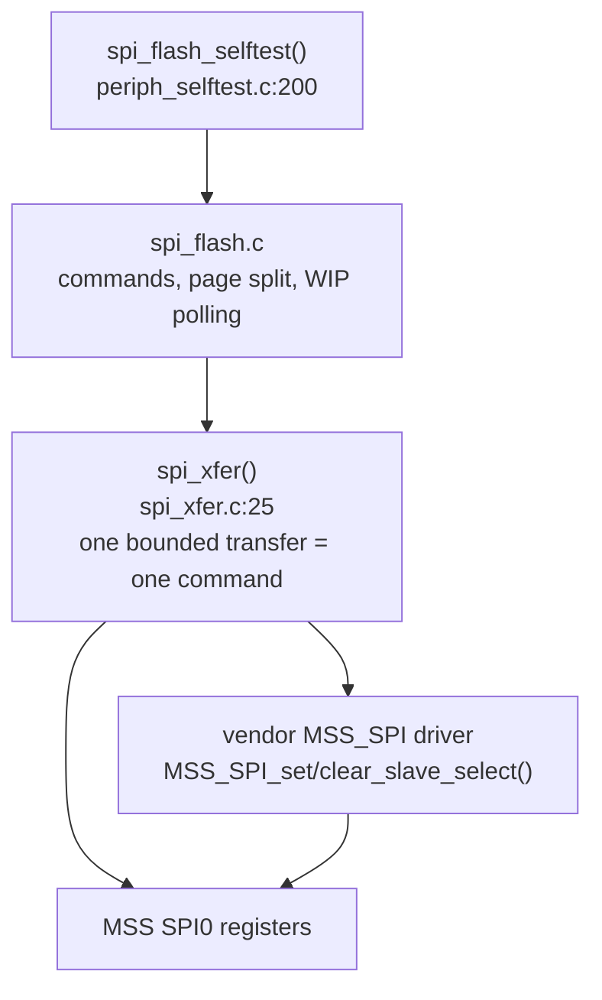
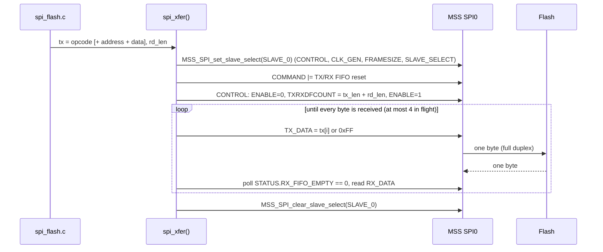
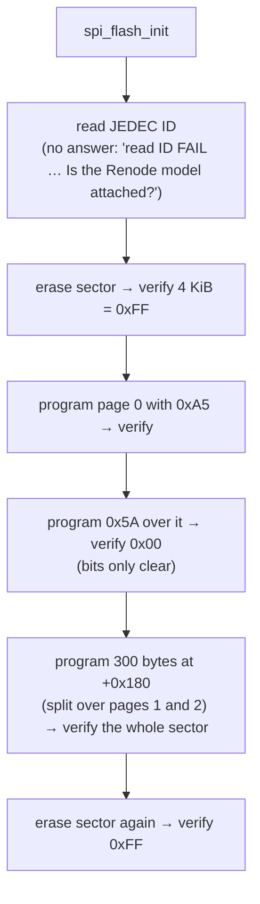

# SPI NOR flash (MSS SPI0)

A 16 MiB serial NOR flash with the common W25Q / MT25Q command subset, on
MSS SPI0, chip select 0. The demo's self-test does these steps:
1. reads the JEDEC ID;
2. erases a sector;
3. programs it;
4. shows that programming can only clear bits;
5. writes across a page boundary;
6. erases again.

Everything is polled; no interrupt is used.

| | |
|---|---|
| Controller | MSS SPI0, `0x2010_8000` (`g_mss_spi0_lo`), master, mode 0, 8-bit frames, clock divider 8 |
| Device | `spi0.flash` in Renode: `renode/models/NorFlash.cs` |
| Firmware | `examples/freertos-demo/spi_flash.c/.h`, `examples/freertos-demo/spi_xfer.c/.h` |
| Self-test | `spi_flash_selftest()` in `examples/freertos-demo/periph_selftest.c`, called from `s_mode_main()` before the scheduler |
| Result line | `[S] SPI0 flash (S-mode, NorFlash model): PASS` |

## 1. Firmware

### 1.1 Layers



### 1.2 Bring-up

- **M-mode pre-hook** (`examples/freertos-demo/m_prehook.c`):
  `mss_config_clk_rst(MSS_PERIPH_SPI0, …, PERIPHERAL_ON)` enables the clock
  and releases the reset. It has to run in M-mode, because it reads
  `mhartid`.
- **`spi_flash_init()`** (`spi_flash.c:78`) calls the vendor driver:
  - `MSS_SPI_init(&g_mss_spi0_lo)`: `CONTROL.RESET` cleared; the SPI0 PLIC
    source (54) disabled through the S-mode-aware `PLIC_DisableIRQ()`.
  - `MSS_SPI_configure_master_mode(…, MSS_SPI_SLAVE_0, MSS_SPI_MODE0, 8, 8,
    NULL)`:
    - sets `CONTROL.MASTER | ENABLE`;
    - stores the slave's configuration: `CONTROL` = master, `SPS` (keep
      SS asserted), `BIGFIFO`, `CLKMODE`, mode 0, frame count 1;
      `CLK_GEN` = 8 / 2 − 1 = 3; `FRAMESIZE` = 8.
    - It is applied by every `MSS_SPI_set_slave_select()`.

### 1.3 MSS SPI registers used

Offsets from `0x2010_8000`, as in `SPI_TypeDef`
(`src/platform/drivers/mss/mss_spi/mss_spi.h`). The bit values used directly
are defined privately in `spi_xfer.c`, the same as `mss_spi.c` defines them.

| Register | Offset | Used by | How |
|---|---|---|---|
| `CONTROL` | 0x00 | `spi_xfer()`, driver | `ENABLE` (bit 0) cleared/set around the reconfiguration; `TXRXDFCOUNT` (bits 8..23) = total bytes of the command; driver: `MASTER`, `SPS`, `BIGFIFO`, `CLKMODE`, mode bits |
| `FRAMESIZE` | 0x04 | `spi_xfer()`, driver | 8 |
| `STATUS` | 0x08 | `spi_xfer()` | `RX_FIFO_EMPTY` (bit 6) polled for received bytes; `TX_FIFO_FULL` (bit 8) before writing |
| `RX_DATA` | 0x10 | `spi_xfer()` | one byte per read |
| `TX_DATA` | 0x14 | `spi_xfer()` | one byte per write (`0xFF` while clocking in data) |
| `CLK_GEN` | 0x18 | driver | 3 (divider 8) |
| `SLAVE_SELECT` | 0x1C | driver (`MSS_SPI_set/clear_slave_select`) | bit 0 = chip select 0 |
| `COMMAND` | 0x2C | `spi_xfer()` | `TX_FIFO_RESET` (bit 3), `RX_FIFO_RESET` (bit 2) at the start |
| `FRAMESUP` | 0x50 | `spi_xfer()` | upper 16 bits of the frame count (0 here) |

`STATUS.RX_DATA_READY` (bit 1) is deliberately **not** used. Renode 1.13's
`MPFS_SPI` sets it only when the received count is a multiple of the frame
size in bits. `RX_FIFO_EMPTY` follows the FIFO directly and works on
hardware as well (see `docs/plan-simulated-peripherals.md`, Phase 1 status).

### 1.4 One command = one transfer (`spi_xfer()`, `spi_xfer.c:25`)

`MSS_SPI_transfer_block()`'s algorithm, with every wait bounded
(`XFER_POLL_LIMIT` = 100000 polls of an empty RX FIFO), so a missing device
gives `SPI_XFER_NO_RESPONSE` instead of hanging:



The whole command goes in **one** transfer, with the frame count set to its
total length. A command is never split over two calls. On hardware the chip
select alone would delimit it. In Renode, `MPFS_SPI` also ends the device's
command when the frame count is reached (section 2.2).

### 1.5 Flash commands (`spi_flash.c`)

| Function | Line | Bytes on the wire | Notes |
|---|---|---|---|
| `spi_flash_read_id()` | 85 | `9F` → 3 bytes | manufacturer, type, capacity |
| `read_status()` | 44 | `05` → 1 byte | bit 0 WIP (busy), bit 1 WEL (write enabled) |
| `write_enable()` | 53 | `06`, then `05` | checks that WEL is set, else `SPI_FLASH_ERR_WEL`: a busy or absent device shows up here |
| `spi_flash_read()` | 117 | `03 A2 A1 A0` → n bytes | in chunks of 256 |
| `spi_flash_program()` | 134 | per page: WREN, `02 A2 A1 A0 d…`, wait | split at 256-byte page boundaries; header + data built in `s_cmd[260]` |
| `spi_flash_erase_sector()` | 164 | WREN, `20 A2 A1 A0`, wait | 4 KiB |
| `spi_flash_wait_ready()` | 92 | `05` repeated | until WIP = 0, at most 1 000 000 reads; counts the busy reads |

### 1.6 Self-test flow (`spi_flash_selftest()`, `periph_selftest.c:200`)

Sector `0x10000`. Each step prints PASS/FAIL and the number of busy status
reads.



Expected output:

```
[S] SPI0 flash: JEDEC ID ef 40 18
[S] SPI0 flash: erase sector -> 0xFF               PASS (busy for 3 status reads)
[S] SPI0 flash: program 0xA5 -> 0xA5               PASS (busy for 3 status reads)
[S] SPI0 flash: program 0x5A over it -> 0x00       PASS (busy for 3 status reads)
[S] SPI0 flash: program across a page boundary     PASS (busy for 6 status reads)
[S] SPI0 flash: erase sector again -> 0xFF         PASS (busy for 3 status reads)
[S] SPI0 flash (S-mode, NorFlash model): PASS
```

## 2. Renode simulation

### 2.1 Files

| File | What |
|---|---|
| `renode/models/NorFlash.cs` | The flash model (custom C#) |
| `renode/mpfs-sim-peripherals.repl` | `flash: SPI.NorFlash @ spi0`: attaches it to the platform's built-in `spi0` (`SPI.MPFS_SPI` at `0x2010_8000`) |
| Debug launcher, `renode/board-setup.resc` | `include @renode/models/NorFlash.cs` before the repl |

### 2.2 The controller: Renode's built-in `MPFS_SPI` (not modified)

These behaviours of the 1.13 model matter for the firmware:
- **One device per controller** (`NullRegistrationPoint`): there is no
  chip-select routing.
- **Synchronous transfers in master mode.** A write to `TX_DATA` calls the
  device's `Transmit(byte)` at once and queues the answer in the RX FIFO.
- **`FinishTransmission()` is called twice.** The device gets it when the
  received count reaches `CONTROL.FRAMECNT`, and again when `SLAVE_SELECT`
  goes to 0.
- **`RXDATRCVD` is unusable** (section 1.3).
- **Unmodelled bits:** `SPS`/`CLKMODE` and `FRAMESUP` warn on every
  transfer. `run-demo.resc` lowers `spi0`'s log level.

### 2.3 `NorFlash.cs` (custom model)

`Antmicro.Renode.Peripherals.SPI.NorFlash : ISPIPeripheral`, about 360
lines, written against the Renode 1.13 API. Its state:
- **`memory`:** a `byte[]` of `size` bytes (default `0x1000000`; a power
  of two), initialised to `0xFF`;
- **`jedecId`:** constructor arguments `manufacturerId`, `memoryType`,
  `capacityId` (default `EF 40 18`);
- **status:** `WriteEnabled` (WEL), `busyPollsLeft` (WIP);
- **the command in progress:** `inCommand`, `command`, `position` (bytes
  after the opcode), `address`, and `pageData[256]` + `pageOffset` +
  `programmed` for page programs.

**Byte handling** (`Transmit()`, line 67): the first byte of a command
is the opcode (`StartCommand()`, line 223). The model answers `0xFF`
while it is receiving the opcode and address.

| Opcode | Command | Behaviour |
|---|---|---|
| `9F` | RDID | returns the 3 ID bytes, then `00` |
| `05` | RDSR | returns `WIP | WEL<<1` on every byte; each read while busy counts down `busyPollsLeft` and, at 0, clears WEL (`ReadStatus()`, line 279) |
| `06` / `04` | WREN / WRDI | set / clear WEL at the end of the command |
| `03` / `0B` | READ / FAST_READ | 3 address bytes (`0B`: plus a dummy byte), then data from `memory[address++]`, wrapping at the end of the array |
| `02` | PAGE PROGRAM | data bytes go into `pageData` at `(pageOffset + n) % 256`: the page buffer wraps, and the last write to a position wins |
| `20` / `D8` | SECTOR / BLOCK ERASE | 4 KiB / 64 KiB to `0xFF` |
| `C7` / `60` | CHIP ERASE | whole array to `0xFF` |

**End of a command** (`FinishTransmission()`, line 131): the command
takes effect here, as on a real part when chip select rises.
- **Page program:** `memory[page + i] &= pageData[i]` for the whole page,
  so programming only clears bits.
- **Erase:** `EraseRange()`, line 310.
- **Checks** (`CheckWrite()`, line 293): program and erase need WEL and a
  well-formed command (exactly 3 address bytes for erases). Otherwise the
  command is ignored with a warning, and `IgnoredCommands` is counted.
- **Busy:** after a program or erase the part is busy for `BusyPolls`
  status reads (default 3). While busy, every command except RDSR is
  ignored, as on real parts.
- **The second call:** `MPFS_SPI`'s second `FinishTransmission()` per
  transfer finds no command in progress and does nothing.

**Monitor interface** (`spi0.flash …`):

| Member | |
|---|---|
| `Programs`, `Erases`, `Commands`, `IgnoredCommands` | counters (`run-demo.resc` prints them) |
| `WriteEnabled`, `Busy`, `Size` | state |
| `BusyPolls` (settable) | status reads that report WIP after each program / erase |
| `Erase` | the whole array to `0xFF` (no busy period) |
| `SaveImage "<file>"`, `LoadImage "<file>"` | keep contents across Renode restarts (a machine reset keeps them anyway) |

### 2.4 Tests of the model

Before running it in Renode, the model was compiled with Mono's `mcs`
against stub Renode interfaces, and driven by a C# harness that copies
`MPFS_SPI`'s call pattern, including the double `FinishTransmission()`.
The harness checked: ID, WEL, erase, program without WREN ignored, a
command ignored while busy, A5 → 5A = 00, page wrap, fast read, counters.
In Renode it is covered by `make sim` / CTest `sim` and the Robot test
"Should Pass The SPI NOR Flash Self-Test".

## 3. On hardware

`spi_flash.c` uses only standard commands, 3-byte addresses and mode 0, so
it suits a W25Q128 / MT25QL128-class part on SPI0 with CS0. Two things to
review:
- `READY_POLL_LIMIT`: a real 4 KiB erase takes up to about 400 ms;
- the clock divider.
