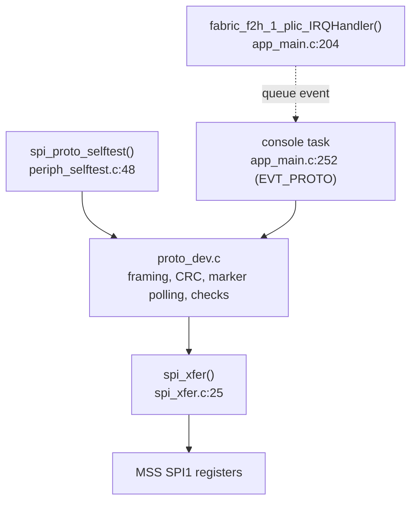
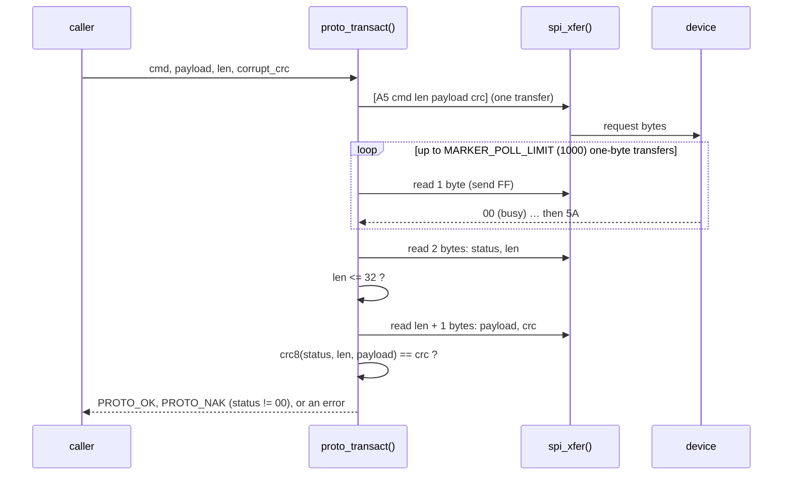
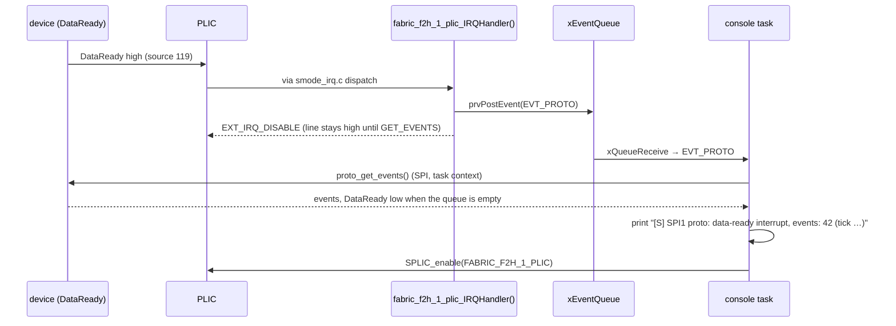

# Example-protocol SPI device (MSS SPI1)

A made-up but realistic "smart" SPI peripheral. It shows a driver for a
device that:
- frames its requests with a CRC;
- needs time before it answers (the master polls for a response marker);
- has a register file and rejects bad requests with a reason;
- can start an interaction itself, through a data-ready interrupt line.

| | |
|---|---|
| Controller | MSS SPI1, `0x2010_9000` (`g_mss_spi1_lo`), master, mode 0, 8-bit frames, clock divider 8 |
| Device | `spi1.proto` in Renode: `renode/models/ProtoSpiDevice.cs` |
| Interrupt | device `DataReady` → fabric line F2M_1 → **PLIC 119**, level, S context |
| Firmware | `examples/freertos-demo/proto_dev.c/.h`, `examples/freertos-demo/spi_xfer.c/.h` |
| Self-test | `spi_proto_selftest()` in `examples/freertos-demo/periph_selftest.c:48`, from `s_mode_main()` before the scheduler (polled) |
| Events | `fabric_f2h_1_plic_IRQHandler()` (`app_main.c:204`) and the console task (`app_main.c:252`) |
| Result lines | `[S] SPI1 proto (S-mode, ProtoSpiDevice): PASS`, `[S] SPI1 proto: data-ready interrupt, events: 42` |

## 1. The protocol

CRC-8 is polynomial `0x07`, initial value `0x00` (CRC-8/SMBUS), computed by
`proto_crc8()` (`proto_dev.c:31`) and by the model's `Crc8()`.

```
request  (one SPI transfer, MOSI):   A5 | cmd | len | payload[len] | crc8(cmd, len, payload)      len <= 32
response (later transfers, MISO):    00 … 00 (not ready) | 5A | status | len | payload[len] | crc8(status, len, payload)
```

- **Reading the response:** the master clocks filler (`FF`) in transfers
  after the request. The device answers `00` until it is ready
  (`ResponseDelay` bytes in the model, default 2), then the marker `5A`,
  then the response.
- **The response survives chip select:** it may be read over several
  transfers.
- **Starting a new request:** a transfer whose **first byte is `A5`**
  starts a new request and drops a response not yet read. Any other input
  byte is filler.
- **Transfer boundaries:** bytes after the request in its own transfer
  are ignored (answered `00`). A transfer that ends in the middle of a
  request drops that request.

| cmd | Name | Request payload | Response payload |
|---|---|---|---|
| `01` | PING | – | `C5 01` (ID, version) |
| `02` | ECHO | 0..32 bytes | the same bytes |
| `03` | READ_REG | addr | value |
| `04` | WRITE_REG | addr, value | – |
| `05` | GET_EVENTS | – | up to 16 queued event bytes (removed from the queue) |

**Registers:** 16 × 8-bit. Register 0 is the ID (`C5`) and register 1 the
version (`01`); both are read-only.

| Status | Name | When |
|---|---|---|
| `00` | OK | |
| `81` | BAD_CRC | CRC mismatch |
| `82` | UNKNOWN_CMD | cmd not in the table |
| `83` | BAD_LEN | len > 32, or the wrong payload length for READ_REG / WRITE_REG |
| `84` | BAD_ADDR | register address ≥ 16 |
| `85` | READ_ONLY | WRITE_REG to register 0 or 1 |

**Data-ready line:** high while at least one event is queued; GET_EVENTS
drops it when it empties the queue.

## 2. Firmware

### 2.1 Layers and registers



The register-level path is the same as for the flash:
- the bounded `spi_xfer()` on `CONTROL`, `FRAMESIZE`, `STATUS`, `RX_DATA`,
  `TX_DATA`, `SLAVE_SELECT`, `COMMAND`, `FRAMESUP`;
- the vendor driver's `MSS_SPI_init()` / `MSS_SPI_configure_master_mode()`
  in `proto_init()` (`proto_dev.c:24`).

See [spi-nor-flash.md](spi-nor-flash.md), sections 1.3 and 1.4, for the
register table and the transfer sequence. SPI1 differs only in its base
(`0x2010_9000`) and PLIC source (55, disabled by `MSS_SPI_init()`; the
controller's own interrupt is not used).

The pre-hook enables SPI1's clock and reset
(`mss_config_clk_rst(MSS_PERIPH_SPI1, …)`).

### 2.2 One transaction (`proto_transact()`, `proto_dev.c:46`)



| Result | Meaning |
|---|---|
| `PROTO_OK` | status `00`, CRC good; payload in `proto_response_t.payload` |
| `PROTO_NAK` | the device answered with a NAK status (`rsp.status`) |
| `PROTO_ERR_BUS` | `spi_xfer()` received nothing (no device) |
| `PROTO_ERR_NO_MARKER` | no `5A` within 1000 polls |
| `PROTO_ERR_BAD_RESPONSE` | length > 32 or CRC mismatch |

The helpers `proto_ping()`, `proto_read_reg()`, `proto_write_reg()` and
`proto_get_events()` (`proto_dev.c:118-145`) wrap it. `corrupt_crc` flips
bit 0 of the request's CRC, for the negative test.
`proto_response_t.marker_polls` counts the `00` bytes read before the
marker.

### 2.3 Self-test (before the scheduler, polled)

`spi_proto_selftest()` (`periph_selftest.c:48`):

| Step | Request | Expected |
|---|---|---|
| 1 | PING | OK, `C5 01` (no answer at all: "PING FAIL … Is the Renode model attached?") |
| 2 | ECHO, 24 bytes | OK, the same bytes |
| 3 | WRITE_REG 5 = `3C`, READ_REG 5 | OK, `3C` |
| 4 | READ_REG `0x20` | NAK `84` BAD_ADDR |
| 5 | WRITE_REG 0 | NAK `85` READ_ONLY |
| 6 | ECHO with a corrupted CRC | NAK `81` BAD_CRC |
| 7 | command `7E` | NAK `82` UNKNOWN_CMD |
| 8 | GET_EVENTS | OK, empty |

### 2.4 Device-initiated events (interrupt-driven, after the scheduler)



- **Enabling the source:** `FABRIC_F2H_1_PLIC` is in `g_smode_irqs[]`
  (`app_main.c:729`), so `s_mode_main()` gives it priority 2 and enables
  it for the S context.
- **No SPI in the handler:** the handler only queues an event; the
  console task does the SPI work.
- **The extra empty interrupt:** when the handler completes, the PLIC
  re-latches the line, which is still high. So after re-enabling, the
  console gets one more `EVT_PROTO` and finds an empty queue. It prints
  nothing for an empty fetch.

## 3. Renode simulation

### 3.1 Files

| File | What |
|---|---|
| `renode/models/ProtoSpiDevice.cs` | The device (custom C#) |
| `renode/mpfs-sim-peripherals.repl` | `proto: SPI.ProtoSpiDevice @ spi1` with `DataReady -> plic@119` |
| `renode/boards.resc` | `spi1.proto InjectEvent 0x42` on board 0 after 1 s (in `$run_and_report`) |
| `renode/expected-uart-board0.txt` | requires the event line (board 0 only) |

It replaced the Phase 1 loopback model on `spi1`: `MPFS_SPI` takes one
device. The controller is Renode's built-in `MPFS_SPI`; its behaviour is
described in [spi-nor-flash.md](spi-nor-flash.md), section 2.2. In
particular it calls `FinishTransmission()` twice per transfer.

### 3.2 `ProtoSpiDevice.cs` (custom model)

`Antmicro.Renode.Peripherals.SPI.ProtoSpiDevice : ISPIPeripheral`, about
360 lines, written against the Renode 1.13 API.

**State:**
- `registers[16]`; `events` (a queue, at most 16);
- `state` (Idle / Request / Response); the request bytes; the response
  bytes, `responseIndex`, `delayLeft`, `markerSent`;
- `startOfTransfer` (set by `FinishTransmission()`) and `requestTransfer`
  (the current transfer carried a request);
- `DataReady`, a `GPIO`, wired in the repl.

**Methods:**

| Method | Line | Role |
|---|---|---|
| `Transmit(byte)` | 78 | The byte state machine. First byte of a transfer = `A5` → start a request. In Request: `ReceiveRequestByte`. In Response: `NextResponseByte`, except in the request's own transfer (answers `00`) |
| `FinishTransmission()` | 117 | Marks "next byte starts a transfer"; drops an unfinished request (`AbortedRequests`). Harmless when called twice |
| `ReceiveRequestByte()` | 157 | Collects cmd, len, payload, crc. len > 32 → BAD_LEN at once; complete frame → CRC check → `Execute` |
| `Execute()` | 188 | The command table (section 1) |
| `Respond()` | 256 | Builds `status len payload crc`, arms `ResponseDelay`, counts NAKs |
| `NextResponseByte()` | 278 | `00` × delay, then `5A`, then the response bytes |
| `InjectEvent(byte)` | 126 | Monitor: queue an event and raise `DataReady` (at most 16, then `EventsDropped`) |
| `Crc8()` | 307 | CRC-8/SMBUS |

**Monitor interface** (`spi1.proto …`):
- `InjectEvent <byte>`, `SetRegister <addr> <value>`, `GetRegister <addr>`;
- `ResponseDelay` (settable);
- counters: `Requests`, `Naks`, `AbortedRequests`, `EventsQueued`,
  `EventsDropped`.

In a SoftConsole session, type `spi1.proto InjectEvent 0x42` in the Renode
monitor at any time to see the event path.

### 3.3 Tests of the model

The model was compiled with `mcs` and tested with a C# harness that copies
`MPFS_SPI`'s call pattern. Its 15 checks covered:
- every command and every NAK;
- a bad length, an aborted request, and a new request dropping an unread
  response;
- the event queue with DataReady;
- the counters.

In Renode it is covered by `make sim` / CTest `sim`, which also inject the
event, and by the Robot tests "Should Pass The SPI Protocol Device
Self-Test" and "Should Deliver An Injected Device Event By Interrupt".

### 3.4 Renode 1.13 findings

- **No device on `spi1`:** if the model is not loaded, `MPFS_SPI` stops
  the emulation with a fatal error (a null device) on the first transfer.
  So the firmware's "no response" path cannot be reached in Renode. Look
  for `Fatal error` in the Renode log if UART1 stops at
  `[S] SPI1 proto: starting`.
- **Splitting a request:** a request split over two firmware transfers
  would be cut by `MPFS_SPI`'s frame-count `FinishTransmission()`, hence
  "one request = one transfer".
